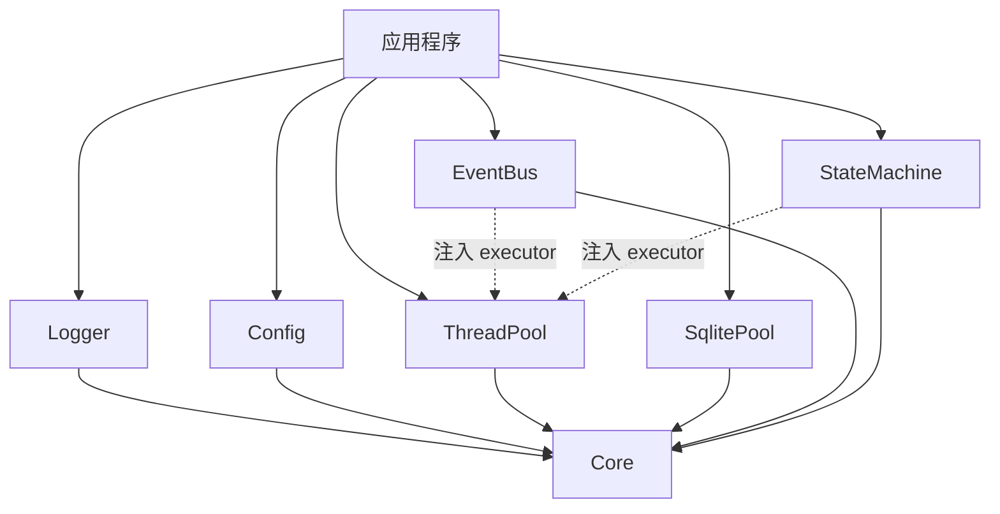

# NovaInfra

NovaInfra 是面向 Linux 应用的模块化 C++17 基础设施库，提供日志、配置、并发、事件、状态机和
SQLite 数据访问等可独立接入的基础组件。

项目强调小而明确的模块边界、RAII 资源管理、有界队列、显式生命周期和可注入的执行器。应用可以
只链接需要的模块，也可以组合成完整的进程内基础设施运行时。

> 当前版本仅支持 Linux，要求 C++17 和 CMake 3.21 或更高版本。

## 模块

| 模块 | CMake target | 主要能力 | 文档 |
| --- | --- | --- | --- |
| Core | `NovaInfra::Core` | 公共类型、宏、断言、平台工具、队列和 header-only 基础设施 | [Core 文档](docs/core.md) |
| Logger | `NovaInfra::Logger` | 同步/异步日志、控制台和文件 Sink、格式化、Registry、Backtrace | [Logger 文档](docs/logger.md) |
| Config | `NovaInfra::Config` | TOML、环境变量和命令行分层加载，Schema 校验，不可变快照和文件监听 | [Config 文档](docs/config.md) |
| ThreadPool | `NovaInfra::ThreadPool` | 固定 worker、有界队列、阻塞/非阻塞提交、`future` 和 drain shutdown | [ThreadPool 文档](docs/thread_pool.md) |
| SqlitePool | `NovaInfra::SqlitePool` | 独占写连接、只读连接池、预编译语句、事务、WAL 和健康检查 | [SqlitePool 文档](docs/sqlite_pool.md) |
| EventBus | `NovaInfra::EventBus` | 类型安全事件发布、RAII 订阅、异步队列、背压和错误统计 | [EventBus 文档](docs/event_bus.md) |
| StateMachine | `NovaInfra::StateMachine` | 基于 Boost.SML 的编译期状态图和有界异步 Runtime | [StateMachine 文档](docs/state_machine.md) |

## 架构

模块依赖关系如下：



`Logger` 和 `SqlitePool` 管理各自需要的后台资源；`EventBus` 和 `StateMachineRuntime` 不创建 worker，
由应用注入 `ThreadPool` 或其他执行器。`Config` 负责配置读取和快照发布，不依赖其他业务基础模块。

完整的分层、数据流和各模块设计说明见 [总体架构文档](docs/architecture.md)。

## 环境要求

- Linux 操作系统。
- CMake 3.21 或更高版本，推荐使用 Ninja。
- 支持 C++17 的编译器和 pthreads。
- 默认启用 `SqlitePool` 时，需要 SQLite3 开发库；使用 SQLCipher 时需要对应的 SQLCipher 和加密库。
- 首次配置会下载 fmt、toml++ 和（测试构建所需的）GoogleTest 固定版本源码。

## 快速开始

### 构建和测试

仓库提供 Debug 和 Release 的 Ninja preset。首次配置时，CMake 会获取项目锁定的第三方头文件和测试框架，
因此需要可用的网络连接。

```bash
cmake --preset linux-ninja-debug
cmake --build --preset build-linux-ninja-debug -j2
ctest --test-dir build/linux-ninja-debug --output-on-failure
```

Release 构建和安装：

```bash
cmake --preset linux-ninja-release
cmake --build --preset build-linux-ninja-release -j2
cmake --install build/linux-ninja-release
```

默认安装前缀为 `install/novainfra`。也可以在配置时通过 `-DCMAKE_INSTALL_PREFIX=<prefix>` 指定其他路径。

### 在外部项目中使用

安装后通过 `find_package` 获取导出的 CMake targets：

```cmake
cmake_minimum_required(VERSION 3.21)
project(example LANGUAGES CXX)

find_package(NovaInfra CONFIG REQUIRED)

add_executable(example main.cpp)
target_compile_features(example PRIVATE cxx_std_17)
target_link_libraries(example PRIVATE NovaInfra::Logger NovaInfra::ThreadPool)
```

如果安装位置不在系统搜索路径中，将安装前缀加入 `CMAKE_PREFIX_PATH`：

```bash
cmake -S . -B build -G Ninja \
  -DCMAKE_PREFIX_PATH=/path/to/NovaInfra/install/novainfra
```

模块的公共头文件和依赖会通过导出的 target 自动传递。Logger 使用项目内置的 header-only fmt，使用方
不需要单独查找或链接 fmt。

## 使用示例

### Logger

```cpp
#include <logger/log.h>

int main()
{
    auto logger = novainfra::log::factories::createConsoleLoggerMt("app");
    logger->setLevel(novainfra::log::Level::INFO);
    logger->info("server started on port {}", 8080);
    logger->flush();
}
```

### ThreadPool

```cpp
#include <thread_pool/thread_pool.h>

int main()
{
    novainfra::threadpool::ThreadPool pool({4, 1024, {}});
    auto result = pool.submit([](int value) { return value * 2; }, 21);
    pool.post([] { /* fire-and-forget task */ });
    return result.get() == 42 ? 0 : 1;
}
```

### Config

```cpp
#include <config/config.h>

#include <cstdint>
#include <string>
#include <utility>

int main(int argc, const char **argv)
{
    novainfra::config::Schema schema;
    schema.required<std::int64_t>("server.port", novainfra::config::FieldConstraints{1, 65535, {}, {}, {}});
    schema.optional<std::string>("server.host", "127.0.0.1");

    auto loaded = novainfra::config::ConfigManager::load(
        std::move(schema), {{"app.toml", true}}, "APP_", argc, argv);
    if (!loaded) {
        return 1;
    }

    auto port = loaded.value().snapshot().get<std::int64_t>("server.port");
    return port ? 0 : 1;
}
```

### EventBus

```cpp
#include <event_bus/event_bus.h>

struct DeviceState { int value = 0; };

int main()
{
    novainfra::eventbus::EventBus bus;
    auto subscription = bus.subscribe<DeviceState>([](const DeviceState &state) {
        // 在发布线程处理事件。
    });
    bus.publish(DeviceState{42});
}
```

更多完整示例位于各模块的 `modules/<module>/examples` 目录，具体生命周期、错误和并发语义以模块文档为准。

## 构建选项

### 模块开关

所有模块默认启用，可以按需关闭：

```bash
cmake -S . -B build/minimal -G Ninja \
  -DMODULES_LOGGER_ENABLE=ON \
  -DMODULES_CONFIG_ENABLE=ON \
  -DMODULES_THREAD_POOL_ENABLE=ON \
  -DMODULES_SQLITE_POOL_ENABLE=OFF \
  -DMODULES_EVENT_BUS_ENABLE=OFF \
  -DMODULES_STATE_MACHINE_ENABLE=OFF
```

主要开关：

| 选项 | 默认值 | 说明 |
| --- | --- | --- |
| `MODULES_LOGGER_ENABLE` | `ON` | 启用 Logger |
| `MODULES_CONFIG_ENABLE` | `ON` | 启用 Config |
| `MODULES_THREAD_POOL_ENABLE` | `ON` | 启用 ThreadPool |
| `MODULES_SQLITE_POOL_ENABLE` | `ON` | 启用 SqlitePool |
| `MODULES_EVENT_BUS_ENABLE` | `ON` | 启用 EventBus |
| `MODULES_STATE_MACHINE_ENABLE` | `ON` | 启用 StateMachine |
| `NOVAINFRA_NO_EXCEPTIONS` | `OFF` | 使用 `-fno-exceptions` 构建；错误处理语义会改变 |
| `NOVAINFRA_SANITIZER` | `NONE` | `ADDRESS` 启用 ASan+UBSan，`THREAD` 单独启用 TSan |
| `NOVAINFRA_ENABLE_IPO` | `OFF` | 在 Release 构建中启用编译器支持的 IPO |
| `SQLITE_BACKEND` | `plain` | 选择 `plain`、`sqlcipher` 或 `auto` |

示例和 benchmark 也可以单独关闭或开启，例如 `NOVAINFRA_LOGGER_BUILD_EXAMPLES`、
`NOVAINFRA_EVENT_BUS_BUILD_BENCHMARKS`、`NOVAINFRA_THREAD_POOL_BUILD_BENCHMARKS` 和
`NOVAINFRA_SQLITE_POOL_BUILD_BENCHMARKS`。Logger、Config、StateMachine 等模块也提供对应的 examples 开关。

### Benchmark

Logger、Config、ThreadPool、SqlitePool 和 EventBus 提供可选 microbenchmark。以 Release 配置为例：

```bash
cmake -S . -B build/performance -G Ninja -DCMAKE_BUILD_TYPE=Release \
  -DNOVAINFRA_CONFIG_BUILD_BENCHMARKS=ON \
  -DNOVAINFRA_LOGGER_BUILD_BENCHMARKS=ON \
  -DNOVAINFRA_THREAD_POOL_BUILD_BENCHMARKS=ON \
  -DNOVAINFRA_SQLITE_POOL_BUILD_BENCHMARKS=ON \
  -DNOVAINFRA_EVENT_BUS_BUILD_BENCHMARKS=ON
cmake --build build/performance
```

Benchmark 用于建立当前机器上的吞吐基线，不代表具体业务任务的性能。新增逐操作或逐任务 P50/P95/P99 和进程峰值 RSS；原批量分位数标为 `batch-mean p95`。

Sanitizer 使用独立构建目录：`-DNOVAINFRA_SANITIZER=ADDRESS` 或 `THREAD`，不能混用。旧开关 `ENABLE_SANITIZERS=ON` 映射为 ADDRESS。CMake preset 使用与最低版本 3.21 兼容的 schema。

完整模块结论、已修复问题和验证记录见 [模块审计与优化实施记录](docs/audit-2026-10.md)。

## 目录结构

```text
NovaInfra/
├── modules/
│   ├── core/
│   ├── logger/
│   ├── config/
│   ├── thread_pool/
│   ├── sqlite_pool/
│   ├── event_bus/
│   └── state_machine/
├── docs/
├── cmake/
├── CMakeLists.txt
├── CMakePresets.json
└── README.md
```

每个模块目录包含自己的公共头文件、实现、示例和测试；`docs/` 保存使用说明和模块架构说明。

## 第三方与许可证

项目包含或获取以下第三方组件：

- fmt 12.2.0，Logger 以 header-only 方式使用。
- toml++ 3.4.0，Config 的私有 TOML 解析依赖。
- GoogleTest 1.15.2，启用测试构建时使用。
- Boost.SML，StateMachine 中随源码 vendored 的单头文件库。
- 部分 Core/Logger 代码来源于 spdlog 的 MIT 许可代码。

版权、许可证文本和来源映射见 [THIRD_PARTY_NOTICES.md](THIRD_PARTY_NOTICES.md) 和 [LICENSE](LICENSE)。
