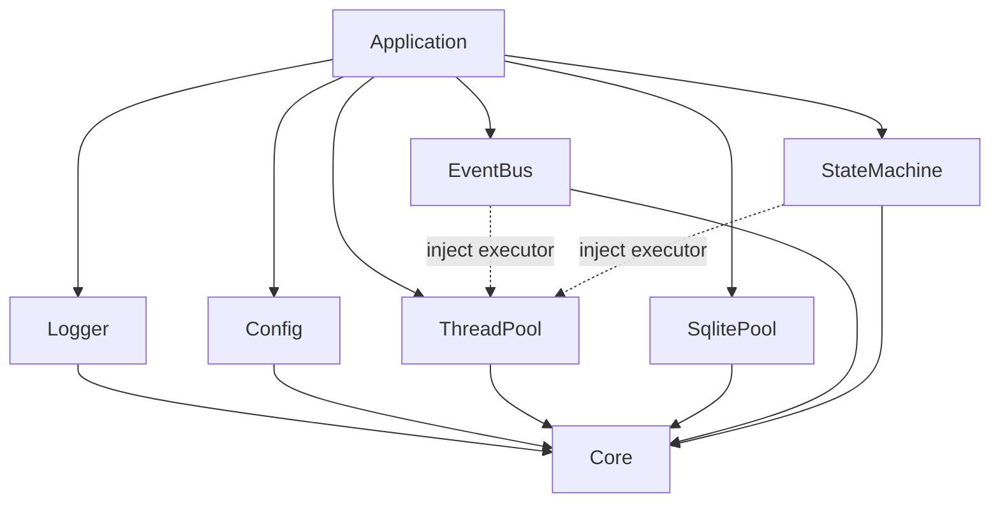

# NovaInfra

**English** | [简体中文](README.zh-CN.md)

NovaInfra is a modular C++17 infrastructure library for Linux applications, providing
independently adoptable building blocks for logging, configuration, concurrency, events,
state machines, and SQLite data access.

The project emphasizes small, well-defined module boundaries, RAII resource management,
bounded queues, explicit lifecycles, and injectable executors. Applications can link only
the modules they need, or combine them into a complete in-process infrastructure runtime.

> The current release supports Linux only and requires C++17 and CMake 3.21 or later.

## Modules

| Module | CMake target | Key capabilities | Docs |
| --- | --- | --- | --- |
| Core | `NovaInfra::Core` | Common types, macros, assertions, platform utilities, queues, and header-only infrastructure | [Core docs](docs/core.md) |
| Logger | `NovaInfra::Logger` | Synchronous/asynchronous logging, console and file sinks, formatting, registry, backtrace | [Logger docs](docs/logger.md) |
| Config | `NovaInfra::Config` | Layered loading from TOML, environment variables, and command line; schema validation; immutable snapshots and file watching | [Config docs](docs/config.md) |
| ThreadPool | `NovaInfra::ThreadPool` | Fixed workers, bounded queue, blocking/non-blocking submission, `future`, and drain shutdown | [ThreadPool docs](docs/thread_pool.md) |
| SqlitePool | `NovaInfra::SqlitePool` | Exclusive write connection, read-only connection pool, prepared statements, transactions, WAL, and health checks | [SqlitePool docs](docs/sqlite_pool.md) |
| EventBus | `NovaInfra::EventBus` | Type-safe event publishing, RAII subscriptions, async queue, backpressure, and error statistics | [EventBus docs](docs/event_bus.md) |
| StateMachine | `NovaInfra::StateMachine` | Compile-time state charts based on Boost.SML and a bounded async runtime | [StateMachine docs](docs/state_machine.md) |

## Architecture

The module dependencies are as follows:



`Logger` and `SqlitePool` manage their own background resources; `EventBus` and
`StateMachineRuntime` do not create workers — the application injects a `ThreadPool` or
another executor. `Config` handles configuration loading and snapshot publishing and does
not depend on the other business infrastructure modules.

See the [overall architecture document](docs/architecture.md) for the complete layering,
data flow, and per-module design notes.

## Requirements

- Linux operating system.
- CMake 3.21 or later; Ninja is recommended.
- A compiler with C++17 support and pthreads.
- SQLite3 development libraries when `SqlitePool` is enabled (the default); the corresponding
  SQLCipher and crypto libraries when using SQLCipher.
- The first configuration downloads pinned source for fmt, toml++, and (for test builds)
  GoogleTest.

## Quick Start

### Build and Test

The repository provides Debug and Release Ninja presets. On the first configuration, CMake
fetches the third-party headers and test framework pinned by the project, so a working
network connection is required.

```bash
cmake --preset linux-ninja-debug
cmake --build --preset build-linux-ninja-debug -j2
ctest --test-dir build/linux-ninja-debug --output-on-failure
```

Release build and install:

```bash
cmake --preset linux-ninja-release
cmake --build --preset build-linux-ninja-release -j2
cmake --install build/linux-ninja-release
```

The default install prefix is `install/novainfra`. You can also specify another path at
configuration time with `-DCMAKE_INSTALL_PREFIX=<prefix>`.

### Use in an External Project

After installation, obtain the exported CMake targets via `find_package`:

```cmake
cmake_minimum_required(VERSION 3.21)
project(example LANGUAGES CXX)

find_package(NovaInfra CONFIG REQUIRED)

add_executable(example main.cpp)
target_compile_features(example PRIVATE cxx_std_17)
target_link_libraries(example PRIVATE NovaInfra::Logger NovaInfra::ThreadPool)
```

If the install location is not on the system search path, add the install prefix to
`CMAKE_PREFIX_PATH`:

```bash
cmake -S . -B build -G Ninja \
  -DCMAKE_PREFIX_PATH=/path/to/NovaInfra/install/novainfra
```

A module's public headers and dependencies are propagated automatically through the exported
targets. Logger uses the project's built-in header-only fmt, so consumers do not need to find
or link fmt separately.

## Usage Examples

### Logger

```cpp
#include <logger/log.h>

int main()
{
    auto logger = novainfra::log::factories::createConsoleLoggerMt("app");
    logger->setLevel(novainfra::log::Level::INFO);
    logger->info("server started on port {}", 8080);
    logger->flush();
}
```

### ThreadPool

```cpp
#include <thread_pool/thread_pool.h>

int main()
{
    novainfra::threadpool::ThreadPool pool({4, 1024, {}});
    auto result = pool.submit([](int value) { return value * 2; }, 21);
    pool.post([] { /* fire-and-forget task */ });
    return result.get() == 42 ? 0 : 1;
}
```

### Config

```cpp
#include <config/config.h>

#include <cstdint>
#include <string>
#include <utility>

int main(int argc, const char **argv)
{
    novainfra::config::Schema schema;
    schema.required<std::int64_t>("server.port", novainfra::config::FieldConstraints{1, 65535, {}, {}, {}});
    schema.optional<std::string>("server.host", "127.0.0.1");

    auto loaded = novainfra::config::ConfigManager::load(
        std::move(schema), {{"app.toml", true}}, "APP_", argc, argv);
    if (!loaded) {
        return 1;
    }

    auto port = loaded.value().snapshot().get<std::int64_t>("server.port");
    return port ? 0 : 1;
}
```

### EventBus

```cpp
#include <event_bus/event_bus.h>

struct DeviceState { int value = 0; };

int main()
{
    novainfra::eventbus::EventBus bus;
    auto subscription = bus.subscribe<DeviceState>([](const DeviceState &state) {
        // Handle the event on the publishing thread.
    });
    bus.publish(DeviceState{42});
}
```

More complete examples live in each module's `modules/<module>/examples` directory. For the
exact lifecycle, error, and concurrency semantics, refer to the module documentation.

## Build Options

### Module Switches

All modules are enabled by default and can be turned off as needed:

```bash
cmake -S . -B build/minimal -G Ninja \
  -DMODULES_LOGGER_ENABLE=ON \
  -DMODULES_CONFIG_ENABLE=ON \
  -DMODULES_THREAD_POOL_ENABLE=ON \
  -DMODULES_SQLITE_POOL_ENABLE=OFF \
  -DMODULES_EVENT_BUS_ENABLE=OFF \
  -DMODULES_STATE_MACHINE_ENABLE=OFF
```

Main switches:

| Option | Default | Description |
| --- | --- | --- |
| `MODULES_LOGGER_ENABLE` | `ON` | Enable Logger |
| `MODULES_CONFIG_ENABLE` | `ON` | Enable Config |
| `MODULES_THREAD_POOL_ENABLE` | `ON` | Enable ThreadPool |
| `MODULES_SQLITE_POOL_ENABLE` | `ON` | Enable SqlitePool |
| `MODULES_EVENT_BUS_ENABLE` | `ON` | Enable EventBus |
| `MODULES_STATE_MACHINE_ENABLE` | `ON` | Enable StateMachine |
| `NOVAINFRA_NO_EXCEPTIONS` | `OFF` | Build with `-fno-exceptions`; error-handling semantics change |
| `NOVAINFRA_SANITIZER` | `NONE` | `ADDRESS` enables ASan+UBSan; `THREAD` enables TSan separately |
| `NOVAINFRA_ENABLE_IPO` | `OFF` | Enable compiler-supported IPO in Release builds |
| `SQLITE_BACKEND` | `plain` | Choose `plain`, `sqlcipher`, or `auto` |

Examples and benchmarks can also be toggled individually, for example
`NOVAINFRA_LOGGER_BUILD_EXAMPLES`, `NOVAINFRA_EVENT_BUS_BUILD_BENCHMARKS`,
`NOVAINFRA_THREAD_POOL_BUILD_BENCHMARKS`, and `NOVAINFRA_SQLITE_POOL_BUILD_BENCHMARKS`.
Modules such as Logger, Config, and StateMachine provide their own examples switches as well.

### Benchmarks

Logger, Config, ThreadPool, SqlitePool, and EventBus provide optional microbenchmarks. Using
a Release configuration as an example:

```bash
cmake -S . -B build/performance -G Ninja -DCMAKE_BUILD_TYPE=Release \
  -DNOVAINFRA_CONFIG_BUILD_BENCHMARKS=ON \
  -DNOVAINFRA_LOGGER_BUILD_BENCHMARKS=ON \
  -DNOVAINFRA_THREAD_POOL_BUILD_BENCHMARKS=ON \
  -DNOVAINFRA_SQLITE_POOL_BUILD_BENCHMARKS=ON \
  -DNOVAINFRA_EVENT_BUS_BUILD_BENCHMARKS=ON
cmake --build build/performance
```

Benchmarks establish a throughput baseline on the current machine and do not represent the
performance of specific business workloads. New per-operation or per-task P50/P95/P99 metrics
and peak process RSS have been added; the original batched quantiles are labeled
`batch-mean p95`.

Sanitizers use a separate build directory: `-DNOVAINFRA_SANITIZER=ADDRESS` or `THREAD`, which
cannot be mixed. The legacy switch `ENABLE_SANITIZERS=ON` maps to ADDRESS. The CMake presets
use a schema compatible with the minimum version 3.21.

See the [module audit and optimization record](docs/audit-2026-10.md) for complete module
conclusions, fixed issues, and verification records.

## Directory Structure

```text
NovaInfra/
├── modules/
│   ├── core/
│   ├── logger/
│   ├── config/
│   ├── thread_pool/
│   ├── sqlite_pool/
│   ├── event_bus/
│   └── state_machine/
├── docs/
├── cmake/
├── CMakeLists.txt
├── CMakePresets.json
└── README.md
```

Each module directory contains its own public headers, implementation, examples, and tests;
`docs/` holds usage guides and module architecture notes.

## Third Party and License

The project includes or fetches the following third-party components:

- fmt 12.2.0, used header-only by Logger.
- toml++ 3.4.0, Config's private TOML parsing dependency.
- GoogleTest 1.15.2, used when test builds are enabled.
- Boost.SML, a single-header library vendored with the source in StateMachine.
- Parts of the Core/Logger code derive from spdlog's MIT-licensed code.

For copyright, license texts, and provenance mapping, see
[THIRD_PARTY_NOTICES.md](THIRD_PARTY_NOTICES.md) and [LICENSE](LICENSE).
