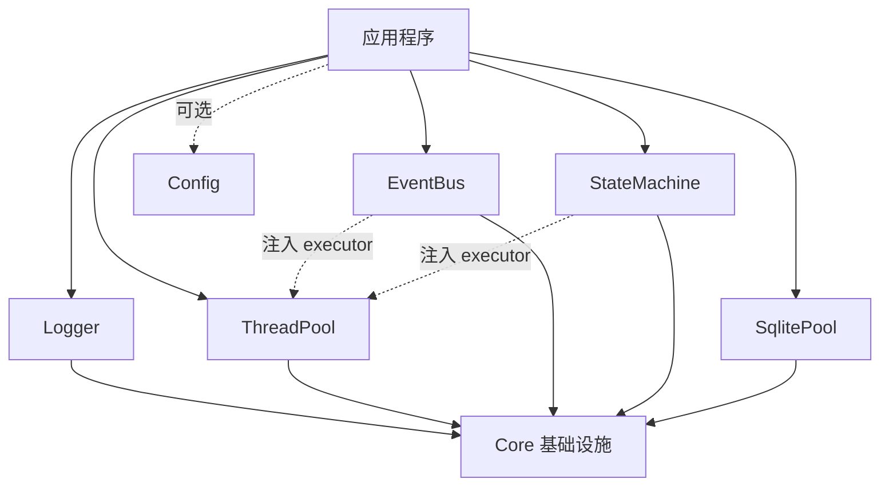
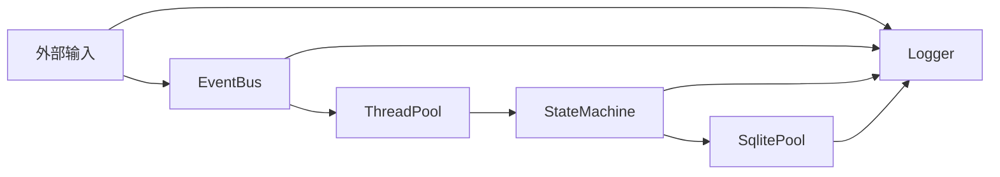

# NovaInfra 总体架构

NovaInfra 是一组面向 Linux 应用的 C++17 基础设施模块。模块通过 CMake 独立构建、安装和测试，公共依赖通过 `NovaInfra::...` 目标表达。应用可以只选择需要的模块，也可以把多个模块组合成完整的运行时基础设施。

## 设计原则

- 模块职责单一，模块之间通过公共 API 和依赖注入协作。
- 资源使用 RAII 管理，连接、订阅、任务和状态机运行时都有明确生命周期。
- 并发组件使用有界队列、显式阻塞策略和可观测状态，避免无限制地积压工作。
- 线程归属清晰：需要线程的组件自己管理线程，不需要线程的组件使用调用方提供的 executor。
- `Core` 提供公共基础设施，业务应用决定事件、状态和持久化如何组合。

## 模块分层

### 基础层

`Core` 是 header-only 基础层，提供类型别名、宏、命名空间、断言、队列和平台辅助工具。其他已实现模块都依赖 `NovaInfra::Core`，但 Core 不依赖上层模块。

### 基础设施层

- **Logger**：同步和异步日志、格式化、日志级别、文件/控制台 sink、注册表和 backtrace。异步模式管理自己的日志处理线程。
- **ThreadPool**：固定数量 worker、有界任务队列、阻塞和非阻塞提交、`future` 结果以及 drain 式关闭。
- **SqlitePool**：一个独占写连接和多个只读连接，提供预编译语句、事务、WAL 维护、连接健康检查以及可选 SQLCipher 接入。

### 集成层

- **EventBus**：进程内类型安全事件总线。同步发布在调用线程执行，异步发布把任务提交到外部 executor；EventBus 本身不创建 worker。
- **StateMachine**：基于 vendored Boost.SML 的编译期状态图，支持 guard、action、层级状态和正交状态。`StateMachineRuntime` 提供有界 FIFO 事件队列，但线程由外部 executor 提供。

### Config

`Config` 提供 TOML 文件、环境变量和命令行来源的分层加载。Schema 负责默认值、必填字段、
类型约束和校验；成功加载后发布不可变快照，读取线程不需要持有配置锁。可选文件轮询监听器
会在解析和校验成功后原子替换快照，失败时保留旧快照并报告诊断。Config 不依赖 Logger、
ThreadPool 或 EventBus。

## 模块文档

- [Core 基础模块架构](core.md)
- [Logger 使用与架构](logger.md)
- [Config 使用与架构](config.md)
- [ThreadPool 使用与架构](thread_pool.md)
- [SqlitePool 使用与架构](sqlite_pool.md)
- [EventBus 使用与架构](event_bus.md)
- [StateMachine 使用与架构](state_machine.md)

## 依赖关系



模块之间没有隐式的全局调度依赖。EventBus 和 StateMachineRuntime 可以接入 `NovaInfra::ThreadPool`，也可以接入应用已有的 executor；SqlitePool 的数据库连接和 Logger 的日志线程分别由各自模块管理。

## 典型运行时数据流



应用通常把输入转换为 typed event，由 EventBus 负责发布；异步工作交给 ThreadPool；状态变化由 StateMachine 处理；需要持久化时使用 SqlitePool；各阶段通过 Logger 记录。这个数据流只是推荐组合方式，模块也可以单独使用。

## 构建、安装和测试

顶层 CMake 通过以下开关控制模块：

- `MODULES_LOGGER_ENABLE`
- `MODULES_EVENT_BUS_ENABLE`
- `MODULES_CONFIG_ENABLE`
- `MODULES_THREAD_POOL_ENABLE`
- `MODULES_SQLITE_POOL_ENABLE`
- `MODULES_STATE_MACHINE_ENABLE`

每个已实现模块导出一个对应的 CMake target，例如 `NovaInfra::Logger`、`NovaInfra::ThreadPool`、`NovaInfra::EventBus`、`NovaInfra::StateMachine` 和 `NovaInfra::SqlitePool`。模块示例默认构建，单元测试在顶层测试构建中加入，benchmark 默认关闭或按模块单独开启。

安装后，应用通过 `find_package(NovaInfra)` 获取导出的目标：

```cmake
find_package(NovaInfra CONFIG REQUIRED)
target_link_libraries(my_app PRIVATE NovaInfra::Core NovaInfra::ThreadPool NovaInfra::SqlitePool)
```

模块的源码、公共头文件、示例和测试放在各自的 `modules/<name>` 目录中，避免跨模块共享实现细节。
