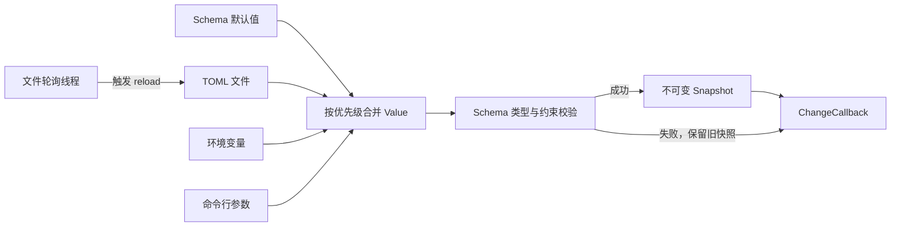

# NovaInfra Config 模块文档

`NovaInfra::Config` 是 NovaInfra 提供的 C++17 配置加载模块，负责把 TOML 文件、环境变量和命令行参数合并为经过 Schema 校验的不可变配置快照。

模块特点：

- 配置来源有明确且固定的优先级。
- 支持多个 TOML 文件按顺序叠加。
- 支持默认值、必填字段、类型检查、范围检查和自定义校验器。
- 加载失败时一次返回全部诊断信息。
- 快照发布后可以安全地被多个线程读取。
- 可选轮询配置文件，并在校验成功后原子替换快照。
- 公共头文件不暴露 toml++ 类型。
- 支持 `NOVAINFRA_NO_EXCEPTIONS=ON` 构建。

Config 不负责远程配置中心、配置文件写回、加密存储或全局单例。应用负责管理
`ConfigManager` 的生命周期，并决定读取到的配置如何应用到 Logger、ThreadPool 或其他模块。

## 模块架构

Config 把多个外部来源转换成一个经过 Schema 校验的不可变 `Snapshot`。加载和重载都复用同一条
构建管线；文件监听器只负责触发重载，不改变配置合并规则。



### 组件职责与数据流

- `Schema` 保存字段类型、默认值、必填标记、范围/长度/枚举约束、自定义校验器和敏感字段标记。
- `Value` 是不暴露 toml++ 类型的内部树，支持标量、数组和对象；对象递归合并，标量和数组整体覆盖。
- `ConfigManager::buildSnapshot()` 依次读取文件、环境变量和命令行，执行类型转换、来源合并、默认值注入和校验。
- `Snapshot` 持有发布后的配置树，只提供读取和脱敏输出，不允许调用方修改已发布内容。
- `startWatching()` 创建独立轮询线程，根据文件变化和 debounce 设置调用重载；监听线程不直接修改当前快照。

来源合并顺序为 `Schema 默认值 < TOML 文件 < 环境变量 < 命令行参数`。任一来源出现语法、读取、类型或
约束错误时，构建返回聚合诊断，不发布半成品快照。

### 并发、生命周期与失败处理

`ConfigManager::Impl` 使用重载互斥量串行化构建，并通过原子共享指针替换当前
`shared_ptr<const Snapshot>`。读取线程只需取得快照副本即可无锁读取；重载期间继续看到旧快照。
监听线程由 `ConfigManager` 管理，析构或 `stopWatching()` 会唤醒并 join 线程。监听回调在发布结果后调用，
回调异常不会把线程传播到调用方。

### 依赖边界

Config 依赖 `NovaInfra::Core`、C++17 线程库和 toml++ 实现细节。toml++ 只出现在模块内部，公共 API 使用
`Value`、`Schema`、`Snapshot` 和 `Result`；Config 不依赖 Logger、ThreadPool 或 EventBus。

## 快速开始

### 定义 Schema

使用 `Schema::required<T>()` 声明必填项，使用 `Schema::optional<T>()` 声明带默认值的可选项。
配置键使用点分隔的层级路径：

```cpp
#include <config/config.h>

#include <cstdint>
#include <string>

novainfra::config::Schema schema;
schema.required<std::int64_t>("server.port", {.min = 1, .max = 65535});
schema.optional<std::string>("server.host", "127.0.0.1");
schema.optional<bool>("server.tls", false);
```

`server.port` 对应 TOML 中的 `[server]` 表下的 `port` 字段。

### 加载配置

```cpp
#include <config/config.h>

#include <iostream>
#include <utility>
#include <vector>

int main(int argc, const char **argv)
{
    novainfra::config::Schema schema;
    schema.required<std::int64_t>("server.port", {.min = 1, .max = 65535});
    schema.optional<std::string>("server.host", "127.0.0.1");

    std::vector<novainfra::config::FileSpec> files{{"app.toml", true}};
    auto loaded = novainfra::config::ConfigManager::load(
        std::move(schema), files, "APP_", argc, argv);

    if (!loaded) {
        std::cerr << loaded.error().message() << '\n';
        return 1;
    }

    const auto snapshot = loaded.value().snapshot();
    auto port = snapshot.get<int>("server.port");
    if (!port) {
        std::cerr << port.error().message() << '\n';
        return 1;
    }

    std::cout << "server port: " << port.value() << '\n';
}
```

`ConfigManager::load()` 返回 `Result<ConfigManager>`。返回成功时，配置已经完成文件读取、来源合并、
默认值注入和 Schema 校验；返回失败时，不会产生可用的半成品 Manager。

### 配置文件示例

`app.toml`：

```toml
[server]
host = "0.0.0.0"
port = 8080
tls = false
```

启动时可以使用环境变量或命令行覆盖文件中的值：

```bash
APP_SERVER_PORT=9090 ./my_app --server.tls=true
```

最终结果为：`server.host` 来自 TOML，`server.port` 来自环境变量，`server.tls` 来自命令行。

## 配置来源和优先级

Config 按以下顺序合并来源，后面的来源覆盖前面的来源：

```text
Schema 默认值 < TOML 文件 < 环境变量 < 命令行参数
```

### Schema 默认值

默认值只在对应键不存在时注入：

```cpp
schema.optional<std::int64_t>("server.port", 8080);
```

如果 TOML、环境变量或命令行提供了 `server.port`，这些值会覆盖 `8080`。

### 多个 TOML 文件

文件按照传入顺序读取和合并，后一个文件覆盖前一个文件：

```cpp
std::vector<novainfra::config::FileSpec> files{
    {"config.toml", true},
    {"config.production.toml", false},
    {"config.local.toml", false},
};

auto loaded = novainfra::config::ConfigManager::load(std::move(schema), files);
```

`FileSpec::required` 的含义：

- `true`：文件不存在或无法读取时加载失败。
- `false`：文件不存在时视为空配置继续加载；如果文件存在但 TOML 语法错误，仍然加载失败。

可选文件存在但无法读取，或路径指向目录时，会返回 `FILE_READ`，不会按文件缺失处理。
必需文件不存在返回 `FILE_NOT_FOUND`。

对象会递归合并。标量和数组是整体替换，不会逐元素合并：

```toml
# config.toml
[server]
host = "127.0.0.1"
port = 8080
```

```toml
# config.production.toml
[server]
port = 443
```

合并后同时保留 `server.host` 和新的 `server.port`。

### 环境变量

传入 `envPrefix` 后，Config 会扫描当前进程环境变量。环境变量名去掉前缀后，所有下划线会转换为
层级分隔符，并统一转换为小写：

```cpp
auto loaded = novainfra::config::ConfigManager::load(
    std::move(schema), files, "APP_", argc, argv);
```

```text
APP_SERVER_PORT=9090       -> server.port = 9090
APP_SERVER_HOST=example    -> server.host = "example"
APP_SERVER_TLS=1           -> server.tls = true
APP_SERVER_TLS=off         -> server.tls = false
```

环境变量会根据 Schema 中声明的类型转换：字符串原样保留；整数支持十进制和 `0x` 十六进制；
浮点数按浮点格式解析；布尔值支持 `true/false`、`yes/no`、`on/off` 和 `1/0`。

整数必须完整落入声明类型的 64 位范围，无符号整数不接受负号。浮点数不接受 NaN、无穷大或溢出值；
非法值返回 `TYPE_MISMATCH`。命令行覆盖同样执行这些检查。

已声明字段无法转换时，会返回 `TYPE_MISMATCH` 诊断，不会静默使用默认值。

### 命令行参数

Config 解析从 `argv[1]` 开始的命令行参数，支持以下形式：

```bash
./my_app --server.port=9090
./my_app --set server.port=9090
./my_app --no-server.tls
```

- `--key=value`：设置一个配置键。
- `--set key=value`：显式设置一个配置键。
- `--no-key`：把布尔配置键设置为 `false`。
- `--`：停止 Config 参数解析，后面的参数由应用自行处理。

当前实现要求带值参数使用 `=`。例如 `--server.port 9090` 不会被当作配置覆盖。
缺少 `=`、`--set` 没有后续值等情况会返回 `INVALID_COMMAND_LINE` 诊断。

## TOML 数据类型

Config 的内部 `Value` 支持空值、布尔值、有符号整数、无符号整数、浮点数、字符串、数组和对象。

```toml
enabled = true
workers = 4
timeout = 2.5
name = "novainfra"
hosts = ["127.0.0.1", "127.0.0.2"]

[database]
path = "data/app.db"
```

TOML 解析由 toml++ 3.4.0 完成。语法错误会包含文件路径、行号、列号和解析器诊断信息。
Config 不会把一个错误的文件降级为空配置。

## Schema 校验

### 必填项和默认值

```cpp
schema.required<std::string>("database.path");
schema.optional<std::int64_t>("database.pool_size", 4);
```

缺少 `database.path` 会导致加载失败。`database.pool_size` 缺少时会注入 `4`。

### 数值范围

```cpp
schema.required<std::int64_t>(
    "server.port", {.min = 1, .max = 65535});

schema.optional<double>(
    "server.timeout_seconds", 5.0, {.min = 0.1, .max = 300.0});
```

范围校验失败会返回 `INVALID_VALUE`。范围字段使用 `double` 表示约束，业务需要避免超出可精确表示的极大整数范围。

### 字符串约束和枚举

```cpp
novainfra::config::FieldConstraints modeConstraints;
modeConstraints.minLength = 1;
modeConstraints.maxLength = 16;
modeConstraints.allowed = {"development", "production"};

schema.optional<std::string>(
    "runtime.mode", "development", modeConstraints);
```

`minLength` 和 `maxLength` 适用于字符串，`allowed` 目前按完整字符串匹配。

### 自定义校验器

校验器接收已经完成来源合并和类型转换的 `Value`。返回空 `std::optional` 表示通过，返回字符串表示失败原因：

```cpp
schema.required<std::string>(
    "database.path",
    {},
    false,
    [](const novainfra::config::Value &value) -> std::optional<std::string> {
        const auto *path = std::get_if<std::string>(&value.storage());
        if (path && path->find(".db") != std::string::npos) {
            return std::nullopt;
        }
        return "database.path must point to a .db file";
    });
```

### 未知键

默认情况下，Schema 未声明的叶子键会导致 `UNKNOWN_KEY` 错误：

```toml
unexpected = true
```

如果应用需要保留插件或扩展字段，可以显式允许一个前缀：

```cpp
schema.allowUnknown("plugin");
```

这只允许 `plugin` 或 `plugin.*` 下的键，其他未知键仍然失败。传入空前缀可以允许所有未知键，
但这会降低拼写错误的可发现性，生产配置通常应保持默认的严格模式。

如果整个对象需要由业务自行解析，可声明 `schema.required<novainfra::config::Value>("plugin")`。
此时 `plugin` 下的子键也被视为已声明，其他路径仍需单独声明或允许。

### 敏感字段

Schema 注册字段时可以标记为敏感字段：

```cpp
schema.required<std::string>("database.password", {}, true);
```

敏感字段元数据可通过 `Schema::isSecret()` 查询。调试输出应使用快照默认的脱敏形式，避免把凭据
写入日志或错误报告。应用仍然可以通过 `Snapshot::get<std::string>()` 显式读取原始值。

## 读取快照

### 类型化读取

```cpp
const auto snapshot = manager.snapshot();

auto host = snapshot.get<std::string>("server.host");
auto port = snapshot.get<int>("server.port");
auto tls = snapshot.get<bool>("server.tls");

if (!port) {
    std::cerr << port.error().message() << '\n';
}
```

`Snapshot::get<T>()` 支持字符串、布尔值、有符号整数、无符号整数和浮点数。整数读取会检查目标类型上下界；
例如配置为 `5000000000` 时，`get<int>()` 返回 `TYPE_MISMATCH`，`get<std::int64_t>()` 可正常读取。
浮点读取可以接受整数值。

### 通用 Value 访问

需要处理动态或扩展配置时，可以读取 `Value`：

```cpp
auto plugin = snapshot.get<novainfra::config::Value>("plugin");
if (plugin) {
    std::cout << plugin.value().toString(false) << '\n';
}
```

也可以使用：

```cpp
snapshot.contains("server.port");
snapshot.find("server.port");
snapshot.root();
snapshot.dump();
```

`find()` 找不到键时返回 `nullptr`。`dump()` 默认使用脱敏输出，适合调试和诊断；需要查看原始字符串时必须显式传入 `false`，并确认输出目标不会暴露敏感配置。

### 快照生命周期

快照是不可变值对象。`ConfigManager::snapshot()` 返回当前快照的副本，Manager 后续 reload 不会修改已经取得的快照。多个线程可以同时读取各自持有的快照，不需要额外的配置锁。

## 错误和诊断

Config 核心 API 使用 `Result<T>`，不要求通过异常传递配置错误：

```cpp
auto loaded = novainfra::config::ConfigManager::load(std::move(schema), files);
if (!loaded) {
    for (const auto &diagnostic : loaded.error().diagnostics) {
        std::cerr << diagnostic.message << '\n';
    }
}
```

`Error::message()` 会把所有诊断格式化为多行文本。诊断包含错误类别、相关配置路径、来源、TOML 行列号和面向调用方的描述。

`ErrorCode` 枚举量遵循项目统一约定，使用全大写蛇形命名。常见错误码：

| 错误码 | 含义 |
|---|---|
| `FILE_NOT_FOUND` | 必需 TOML 文件不存在 |
| `FILE_READ` | TOML 文件存在但无法读取或不是普通文件 |
| `PARSE` | TOML 语法解析失败 |
| `INVALID_COMMAND_LINE` | 命令行格式错误 |
| `TYPE_MISMATCH` | 来源值与 Schema 类型不匹配 |
| `MISSING_REQUIRED` | 缺少必填键 |
| `INVALID_VALUE` | 范围、长度或自定义校验失败 |
| `UNKNOWN_KEY` | 出现未声明配置键 |
| `RELOAD_FAILED` | Manager 状态无效导致 reload 失败 |

一次加载会聚合 Schema 校验问题。例如配置同时缺少两个必填字段并包含一个未知键时，调用方可以一次看到三个诊断，而不需要反复启动程序。

## 配置重载和文件监听

### 显式 reload

```cpp
auto result = manager.reload();
if (!result) {
    std::cerr << "reload failed: " << result.error().message() << '\n';
}
```

`reload()` 会重新读取全部 TOML 文件、环境变量和命令行来源，然后重新执行合并、默认值注入和 Schema 校验。失败时保留旧快照；成功时一次性替换当前快照。

### 轮询监听

```cpp
novainfra::config::WatchOptions options;
options.interval = std::chrono::milliseconds(1000);
options.debounce = std::chrono::milliseconds(200);

auto watching = manager.startWatching(
    options,
    [](const novainfra::config::Snapshot &snapshot,
       const novainfra::config::Error *error) {
        if (error) {
            std::cerr << "configuration reload failed: "
                      << error->message() << '\n';
            return;
        }
        std::cout << "configuration reloaded: "
                  << snapshot.dump() << '\n';
    });
```

监听器使用标准库轮询配置文件修改时间，不依赖 inotify。检测到变化后会等待去抖时间，再重新检查文件并执行完整 reload：

1. 读取全部配置来源。
2. 合并配置树。
3. 注入默认值。
4. 执行全部 Schema 校验。
5. 全部成功后原子替换快照。

任一步失败都不会替换旧快照，并通过回调的 `error` 参数报告诊断。回调的 `error` 为 `nullptr` 表示 reload 成功。
不传回调时，监听器仍会在校验成功后发布新快照。

`WatchOptions::interval` 必须大于零，`debounce` 不能为负；无效参数使 `startWatching()` 返回
`INVALID_VALUE`。停止监听会唤醒等待中的线程，无需等待完整轮询间隔。

在支持异常的构建中，若监听回调抛出异常，自动监听会停止；异常可通过
`manager.watchFailure()` 获取（类型为 `std::exception_ptr`）。再次成功启动监听会清除旧异常。
成功重载的快照在调用回调前已发布，因此回调异常不会回滚该快照。应用应根据异常决定是否恢复监听，
并处理可能尚未完成的业务配置应用。

停止监听：

```cpp
manager.stopWatching();
```

Manager 析构时也会停止监听线程。回调中可调用 `stopWatching()` 发出停止请求；旧监听线程尚未退出时，
`startWatching()` 返回 `RELOAD_FAILED`。监听回调运行在线程中，应该保持短小，不应执行长时间的文件或网络操作。

## 构建与测试

### NovaInfra 仓库内构建

```bash
cmake --preset linux-ninja-debug
cmake --build --preset build-linux-ninja-debug -j2
ctest --test-dir build/linux-ninja-debug -R '^Config' --output-on-failure
```

Config 模块由 `MODULES_CONFIG_ENABLE` 控制，示例由 `NOVAINFRA_CONFIG_BUILD_EXAMPLES` 控制：

```bash
cmake -S . -B build/config \
  -DMODULES_CONFIG_ENABLE=ON \
  -DNOVAINFRA_CONFIG_BUILD_EXAMPLES=ON
```

### 外部项目使用

```cmake
find_package(NovaInfra CONFIG REQUIRED)

add_executable(my_app main.cpp)
target_link_libraries(my_app PRIVATE NovaInfra::Config)
```

如果安装目录不在系统搜索路径中，设置 `CMAKE_PREFIX_PATH`。Config 的公共头文件位于
`<config/config.h>` 等路径。toml++ 是 Config 的私有构建依赖，应用不需要直接包含或链接 toml++。

### 无异常构建

```bash
cmake -S . -B build/no-exceptions \
  -DNOVAINFRA_NO_EXCEPTIONS=ON \
  -DMODULES_CONFIG_ENABLE=ON
cmake --build build/no-exceptions --target novainfra_config
```

Config 的加载、校验、读取和重载错误通过 `Result` 返回，不依赖异常。应用应检查 `load()`、`reload()`、
`startWatching()` 和 `Snapshot::get<T>()` 的返回值。

## 使用建议和当前限制

生产环境建议：

- 对网络端口、超时、线程数等资源字段设置范围约束。
- 对密码、令牌等凭据使用敏感字段标记，不把 `dump(false)` 写入普通日志。
- 把环境差异放入环境变量或单独的 TOML 覆盖文件。
- 把必须存在的配置声明为 `required<T>()`，避免运行到业务深处才发现缺少配置。
- 热加载只用于可以安全重新应用的配置；不可动态变更的字段应由应用拒绝或触发重启。

当前版本不包含：

- JSON、YAML、INI 文件源。
- 远程配置中心或 Etcd、Consul 集成。
- 配置文件写回和安全持久化。
- 加密存储和密钥轮换。
- C++ 反射式自动绑定。
- 多进程之间的配置变更协调。
