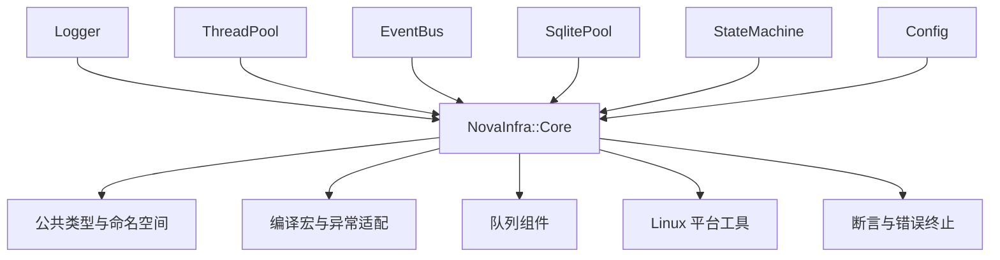

# NovaInfra Core 模块文档

`NovaInfra::Core` 是 NovaInfra 的 header-only 基础层。它不创建线程、不持有进程级服务，也不依赖
Logger、ThreadPool 或其他上层模块；其职责是为所有模块提供一致的类型、编译宏、平台辅助函数、
断言和基础队列实现。

## 模块架构



### 组件职责与数据流

- `core/namespace.h`、`core/types.h` 和 `core/version.h` 提供命名空间、整数别名、字节缓冲区、时间点、任务和版本信息。
- `core/macros.h` 统一 `NOVAINFRA_NOEXCEPT`、异常捕获、不可复制/移动声明和编译期特性，使模块可以共享 `NOVAINFRA_NO_EXCEPTIONS` 构建约定。
- `core/mpmc_blocking_queue.h` 提供多生产者、多消费者队列，支持阻塞、非阻塞、有界入队和丢弃/覆盖统计。
- `core/circular_queue.h` 提供固定容量的环形缓冲，满载时覆盖最旧元素，主要用于日志 backtrace 等保留最近数据的场景。
- `core/os_utils.h` 提供文件、目录、终端、线程 ID、时间和平台 I/O 辅助函数。
- `core/assert.h` 和 `core/singleton.h` 提供断言失败处理及轻量的进程内单例辅助。

### 并发、生命周期与失败处理

Core 的队列自身使用互斥量、条件变量和原子计数保护状态，但不拥有 worker。调用方负责决定队列
由哪个线程消费、何时停止生产以及如何处理关闭时的剩余元素。`CircularQueue` 不是线程安全容器，
需要由外部串行化访问。

Core 中的工具函数和类型别名不管理业务资源。上层模块通过 RAII 对象管理连接、任务、订阅和线程，
这样 Core 只承担通用机制，不引入跨模块生命周期依赖。

### 依赖边界

Core 只依赖 C++17 标准库和 Linux 平台接口。上层模块可以直接链接 `NovaInfra::Core`；Core 不反向依赖
任何上层 target，也不提供全局 executor、日志器或配置中心。

## 构建与测试

### 构建与使用

`NovaInfra::Core` 是接口库，安装时只复制头文件并导出 CMake target：

```cmake
find_package(NovaInfra CONFIG REQUIRED)
target_link_libraries(my_app PRIVATE NovaInfra::Core)
```

通常应用不需要单独链接 Core，因为其他 NovaInfra 模块会传递其 include path 和 Core 依赖。
