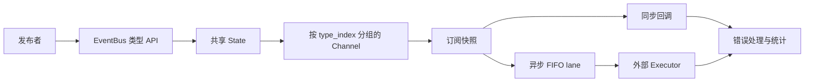

# NovaInfra EventBus 模块文档

`NovaInfra::EventBus` 是一个进程内、类型安全的事件分发器。它不创建自己的 worker；异步事件通过
`EventBusOptions::executor` 注入调度器，因此可以接入 `NovaInfra::ThreadPool` 或应用已有的执行器。

## 模块架构



`EventBus` 的公共模板 API 将事件类型映射为 `type_index`，内部用类型擦除的 payload 和回调保存
订阅。每种事件类型拥有独立 Channel；Channel 保存订阅列表、异步队列和调度标记，因此不同事件
类型可以并行处理，同一类型保持 FIFO。

### 组件职责与数据流

- `EventBus` 负责模板类型检查、发布入口和生命周期操作。
- `Subscription` 持有共享 Slot，析构或 `cancel()` 只改变 Slot 的 active 标记，不要求回调正在执行时取得总线锁。
- `State` 保护 Channel、队列、统计和关闭状态；发布时复制订阅快照，回调在释放内部锁后执行。
- 同步发布直接在发布线程依次调用快照中的回调；异步发布把 payload 和快照封装为任务，交给注入的 executor。
- executor 只接受 `EventTask`，EventBus 不创建 worker，也不规定 executor 必须是 ThreadPool。

### 并发、生命周期与失败处理

异步队列容量只统计等待中的事件，不包含当前执行的回调。队列满策略由 `EventBusOptions` 决定：阻塞、
立即拒绝或丢弃新事件。异步事件入队时固定订阅快照，因此入队后新增的订阅者不会收到该事件。

关闭会先停止接收新事件。`DRAIN` 保留已接受事件并等待 Channel 排空，`DISCARD` 清除尚未执行的任务；
关闭期间回调异常交给 `onError`，不会阻止同一事件的其他订阅者。总线回调中不能对同一总线执行阻塞式
`shutdown(DRAIN)`，避免自等待。

### 依赖边界

EventBus 依赖 `NovaInfra::Core` 和线程库，依赖方向是应用注入 executor。它不依赖 ThreadPool、Logger 或
StateMachine；应用可以把事件回调连接到这些模块，但组合关系由应用持有和管理。

## 快速开始

```cpp
#include <event_bus/event_bus.h>

struct UserCreated { int id = 0; };
novainfra::eventbus::EventBus bus;
auto subscription = bus.subscribe<UserCreated>([](const UserCreated &event) {
    // This runs on the publishing thread.
});
auto report = bus.publish(UserCreated{7});
```

订阅句柄是移动语义的 RAII 对象，析构或 `cancel()` 会取消订阅。发布按注册顺序执行订阅快照，
回调不在总线内部锁中运行。取消不会启动新的回调，已经开始的回调允许完成。

## 异步发布和背压

```cpp
novainfra::threadpool::ThreadPool pool({4, 1024, {}});
novainfra::eventbus::EventBusOptions options;
options.queueCapacity = 256;
options.executor = [&pool](novainfra::eventbus::EventTask task) {
    return pool.tryPost(std::move(task));
};
novainfra::eventbus::EventBus bus(options);

auto status = bus.publishAsync(UserCreated{8});
auto immediate = bus.tryPublishAsync(UserCreated{9});
```

队列容量统计所有待处理事件，不包含正在执行的回调。`QueueFullPolicy` 支持阻塞、立即失败和丢弃
新事件；`tryPublishAsync` 始终不阻塞。返回值区分接受、无订阅者、队列已满、丢弃、关闭、无执行器
和执行器拒绝。

每个事件类型拥有独立 FIFO lane，不同事件类型可以并行。异步事件在入队时取得订阅快照，之后新增
的订阅者不会收到已经入队的事件。

## 错误和关闭

回调异常不会阻止同一事件的其他订阅者。`EventBusOptions::onError` 接收事件类型、订阅 ID 和
`exception_ptr`；未配置处理器时向 `stderr` 输出诊断并保留统计信息。`shutdown(DRAIN)` 停止新提交并排空已接受事件，
`shutdown(DISCARD)` 丢弃尚未开始的事件。关闭后同步 `publish` 会抛出 `std::runtime_error`，
异步发布返回 `STOPPED`。不能从目标总线的回调中调用其 `shutdown(DRAIN)`，即使该回调通过其他总线
嵌套调用；此时会抛出 `std::logic_error`。`shutdown(DRAIN)` 会等待异步队列排空，生产环境应在销毁外部
执行器前显式调用它，并保证 executor 的生命周期覆盖整个关闭过程。

总线不提供字符串主题、持久化、重放或跨进程传输；需要这些能力时应在边界层实现序列化和消息代理。

## 构建与测试

```bash
cmake --preset linux-ninja-debug
cmake --build --preset build-linux-ninja-debug -j2
ctest --test-dir build/linux-ninja-debug -R '^EventBus' --output-on-failure
```

基准通过 `-DNOVAINFRA_EVENT_BUS_BUILD_BENCHMARKS=ON` 构建。
