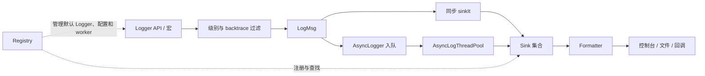

# NovaInfra Logger 模块文档

NovaInfra Logger 是 NovaInfra 的日志模块，提供同步与异步日志、控制台与文件输出、格式化、级别过滤、
默认 Logger 管理和扩展接口。本文只介绍公开 API 的使用方式和运行边界。

## 功能概览

NovaInfra Logger 当前支持：

- 同步 Logger 和基于有界队列的异步 Logger
- 控制台、普通文件和按大小滚动的文件 Sink
- 多线程安全的 `Mt` Sink 和无内部锁的 `St` Sink
- fmt 风格参数格式化和可配置输出 Pattern
- Logger 与 Sink 两级日志过滤及自动 Flush 级别
- 显式 Logger 宏、默认 Logger 宏和编译期日志裁剪
- 默认 Logger、命名 Logger 和全局配置 Registry
- Backtrace 缓冲、文件生命周期回调和错误处理器
- 自定义 Sink 与 Formatter

模块要求 Linux 和 C++17。它不负责多个进程同时写入同一个文件时的协调；异步 Logger 使用多个
Worker 时也不保证不同消息之间的处理顺序。

## 模块架构



Logger 将“生成日志消息”和“写入输出”分层：`Logger` 负责级别判断、fmt 格式化、Flush 级别和
backtrace；`LogMsg` 携带结构化消息和源码位置；`Sink` 负责线程安全策略、Formatter 和最终 I/O。
一个 Logger 可以拥有多个 Sink，每个 Sink 独立过滤和输出。

### 组件职责与数据流

- 同步 Logger 在调用线程完成 `LogMsg` 创建、Sink 过滤、格式化和写入。
- `AsyncLogger` 只在调用线程完成过滤和消息封装，把 `AsyncLogMsg` 投递到有界 `AsyncLogThreadPool`。
- 异步 worker 从队列取消息，在后台调用 Logger 的 backend sink 和 flush；队列溢出由阻塞、丢弃或覆盖策略决定。
- 多 worker 可以并行消费，线程安全由 `Mt` Sink 提供；异步模式不保证不同消息的全局顺序。

### 并发、生命周期与失败处理

`Registry` 保存命名 Logger、默认 Logger、全局级别/Formatter、错误处理器和异步 worker 的共享指针。
Factory 创建的 Logger 可自动注册，Logger 和 Sink 通过 `shared_ptr` 管理。异步队列中的消息会持有
必要的 Logger 生命周期，避免 worker 执行时对象提前销毁。

`Registry::shutdown()` 负责停止并 drain Registry 管理的异步 worker、刷新日志并重置全局状态。应用应在
相关 Sink、文件和进程资源销毁前完成关闭；直接管理异步 worker 时也必须保证 worker 生命周期覆盖所有 Logger。

### 依赖边界

Logger 依赖 `NovaInfra::Core`、线程库和 vendored fmt。Formatter、Sink 和文件事件回调是扩展点；Logger 不
依赖 ThreadPool、EventBus 或 Config。应用可以在日志回调中接入其他模块，但不能把 Logger 的后台 worker
当作通用任务执行器。

## 构建与测试

### 在 NovaInfra 仓库中构建

```bash
cmake --preset linux-ninja-debug
cmake --build --preset build-linux-ninja-debug -j2
```

Logger 示例默认通过 `NOVAINFRA_LOGGER_BUILD_EXAMPLES=ON` 构建，生成的可执行文件位于
`build/linux-ninja-debug/modules/logger/`。

### 在外部 CMake 项目中使用

先构建并安装 NovaInfra：

```bash
cmake --preset linux-ninja-release
cmake --build --preset build-linux-ninja-release -j2
cmake --install build/linux-ninja-release
```

应用项目通过 CMake package 链接 Logger：

```cmake
find_package(NovaInfra CONFIG REQUIRED)

add_executable(my_app main.cpp)
target_link_libraries(my_app PRIVATE NovaInfra::Logger)
```

如果 NovaInfra 安装在非系统目录，需要将安装前缀加入 `CMAKE_PREFIX_PATH`。仓库 preset 的默认安装
目录是 `install/novainfra`。

推荐包含聚合头文件：

```cpp
#include <logger/log.h>
```

`NovaInfra::Logger` 已传递所需的 include path、线程库和 header-only fmt 定义，使用方不需要单独查找或
链接 fmt。安装后的 fmt 头文件位于 `<prefix>/include/third_party/fmt`，外部项目无需直接添加该目录。

## 快速开始

```cpp
#include <logger/log.h>

int main()
{
    auto logger = novainfra::log::factories::createConsoleLoggerMt("app");
    logger->setLevel(novainfra::log::Level::INFO);

    logger->info("server started on port {}", 8080);
    logger->warn("connection count is {}", 42);
    logger->flush();
}
```

`createConsoleLoggerMt()` 创建线程安全的同步控制台 Logger。Factory 创建的 Logger 默认经过
Registry 初始化并自动注册；同名 Logger 已存在时会报告配置错误。

直接构造 `Logger` 时，其默认级别是 `TRACE`。通过 Factory 创建时，Registry 会应用当前全局配置；
Registry 的初始全局级别是 `INFO`。

## 日志级别、格式化与 Flush

### 日志级别

日志级别从低到高排列：

| 级别 | 用途 |
|---|---|
| `TRACE` | 最细粒度的诊断信息 |
| `DEBUG` | 调试信息 |
| `INFO` | 正常运行信息 |
| `WARN` | 可恢复或需要关注的情况 |
| `ERROR` | 当前操作失败 |
| `CRITICAL` | 严重故障 |
| `OFF` | 关闭普通日志输出 |

一条消息必须同时通过 Logger 和 Sink 的级别阈值：

```cpp
logger->setLevel(novainfra::log::Level::INFO);
logger->sinks().front()->setLevel(novainfra::log::Level::WARN);
```

此时 Logger 接收 `INFO` 及以上消息，但该 Sink 只输出 `WARN` 及以上消息。

### fmt 风格格式化

传入额外参数时，日志接口使用 fmt 风格的 `{}` 格式串：

```cpp
logger->info("request {} completed in {:.2f} ms", requestId, elapsedMs);
```

只传入一个字符串参数时，它被当作普通消息，字符串中的花括号不会触发格式化。运行期生成的格式串
可以使用 `fmt::runtime()`。

### Flush

显式刷新所有 Sink：

```cpp
logger->flush();
```

也可以设置自动 Flush 级别：

```cpp
logger->setFlushLevel(novainfra::log::Level::ERROR);
```

同步 Logger 的 `flush()` 在所有 Sink 完成 Flush 后返回。异步 Logger 的语义不同，见“异步日志”。

## Sink 与 Factory

### 内置 Sink

| Sink | Factory | 说明 |
|---|---|---|
| `ConsoleOutSinkMt/St` | `createConsoleLoggerMt/St()` | `TRACE` 到 `INFO` 写入 stdout，`WARN` 及以上写入 stderr |
| `BasicFileSinkMt/St` | `createBasicFileLoggerMt/St()` | 普通文件，默认追加，可选择截断 |
| `RotatingFileSinkMt/St` | `createRotatingFileLoggerMt/St()` | 文件达到大小限制前滚动并保留历史文件 |
| `CallbackSinkMt/St` | `Logger`/`AsyncLogger` | 将原始 `LogMsg` 交给用户回调，不生成格式化文本 |

`Mt` 版本带内部同步，适合多线程直接调用，也可以用于多 Worker 异步 Logger。`St` 版本没有内部锁，
只适用于访问已被外部串行化的场景。

Callback Sink 的回调签名是 `void(const novainfra::log::LogMsg &)`，行为与 spdlog callback sink 一致：回调收到
原始结构化消息，Sink 不会根据 Formatter 生成字符串。回调参数中的 `message`、`loggerName` 和源码
位置是 `string_view`，只在当前回调调用期间有效；需要异步保存时必须复制。空回调会在构造时抛出
`std::invalid_argument`。

```cpp
std::vector<std::string> messages;
auto callback = std::make_shared<novainfra::log::sinks::CallbackSinkMt>(
    [&messages](const novainfra::log::LogMsg &msg) {
        messages.emplace_back(msg.message.data(), msg.message.size());
    });
auto logger = std::make_shared<novainfra::log::Logger>(
    "callback", novainfra::log::sinks::SinkInitList{callback});
logger->info("message from callback sink");
```

`CallbackSinkMt` 可以用于多 Worker AsyncLogger；`CallbackSinkSt` 只能用于同步路径或单 Worker 异步
路径。回调抛出的标准异常会交给 Logger 错误处理器，未知异常保持 Logger 的既有重抛语义。回调不应
重入同一个 Logger 或 Sink，也不应执行不可控的长时间阻塞操作。

### 普通文件

```cpp
auto logger = novainfra::log::factories::createBasicFileLoggerMt(
    "file", "/tmp/application.log", false);
logger->info("append to the log file");
```

第三个参数为 `truncate`，默认 `false` 表示追加；传入 `true` 会在打开时截断文件。不存在的父目录会
自动创建。

### 滚动文件

```cpp
auto logger = novainfra::log::factories::createRotatingFileLoggerMt(
    "rotating", "/tmp/application.log", 10 * 1024 * 1024, 3);
```

参数依次为 Logger 名称、文件名、单个文件最大字节数和历史文件数量。以
`/tmp/application.log` 为例，历史文件命名为 `application.1.log`、`application.2.log` 等。
可选的 `rotateOnOpen=true` 会在打开已有非空文件时立即滚动。

### 一个 Logger 使用多个 Sink

```cpp
auto console = std::make_shared<novainfra::log::sinks::ConsoleOutSinkMt>();
auto file = std::make_shared<novainfra::log::sinks::BasicFileSinkMt>(
    "/tmp/application.log");

auto logger = std::make_shared<novainfra::log::Logger>(
    "app", novainfra::log::sinks::SinkInitList{console, file});
```

直接构造的 Logger 不会自动加入 Registry。需要全局管理时，调用 `registerLogger()`、
`registerOrReplaceLogger()` 或 `setDefaultLogger()`。

## 输出 Pattern

每个 Sink 独立拥有 Formatter。可以直接为 Sink 设置 Pattern：

```cpp
logger->sinks().front()->setPattern(
    "[%Y-%m-%d %H:%M:%S.%e] [%l] [%n] %v");
```

也可以为 Logger 的所有 Sink 设置 Formatter。Logger 会为各 Sink 克隆 Formatter：

```cpp
logger->setFormatter(
    std::make_unique<novainfra::log::formatters::PatternFormatter>("[%l] %v"));
```

默认 Pattern 是 `%+`，输出时间、级别、Logger 名称、线程 ID、可选源码位置和消息。Pattern 默认使用
本地时间；需要 UTC 时可以显式构造 Formatter：

```cpp
using novainfra::log::formatters::PatternFormatter;
using novainfra::log::formatters::PatternTimeType;

logger->setFormatter(std::make_unique<PatternFormatter>(
    "%Y-%m-%d %H:%M:%S [%l] %v", PatternTimeType::UTC));
```

### 消息与进程字段

| 标记 | 内容 |
|---|---|
| `%+` | 默认完整格式 |
| `%v` | 消息正文 |
| `%n` | Logger 名称 |
| `%l` | 日志级别名称 |
| `%t` | 数值线程 ID |
| `%P` | 进程 ID |
| `%%` | 字面量 `%` |

### 源码位置字段

| 标记 | 内容 |
|---|---|
| `%@` | 文件路径和行号 |
| `%s` | 短文件名 |
| `%g` | 完整文件路径 |
| `%#` | 行号 |
| `%!` | 函数名 |

只有使用 Logger 宏或显式传入 `SourceLocation` 时，源码位置字段才有内容。

### 时间字段

| 标记 | 内容 |
|---|---|
| `%a` / `%A` | 星期缩写 / 全称 |
| `%b` / `%h` / `%B` | 月份缩写 / 月份全称 |
| `%c` | 日期时间 |
| `%C` / `%Y` | 两位年份 / 四位年份 |
| `%D` / `%x` | `MM/DD/YY` |
| `%m` / `%d` | 月 / 日 |
| `%H` / `%I` | 24 小时制 / 12 小时制小时 |
| `%M` / `%S` | 分 / 秒 |
| `%e` / `%f` / `%F` | 毫秒 / 微秒 / 纳秒 |
| `%E` | Unix 时间戳秒数 |
| `%p` | AM 或 PM |
| `%r` | 12 小时制时间 |
| `%R` | `HH:MM` |
| `%T` / `%X` | `HH:MM:SS` |

### 相邻消息耗时字段

| 标记 | 内容 |
|---|---|
| `%u` | 距上次消息的纳秒数 |
| `%i` | 距上次消息的微秒数 |
| `%o` | 距上次消息的毫秒数 |
| `%O` | 距上次消息的秒数 |

每个耗时标记独立保存状态，第一次输出为 `0`。不支持的标记或以单独 `%` 结尾的 Pattern 会被拒绝。

## 日志宏

显式 Logger 宏使用传入的 Logger：

```cpp
NOVAINFRA_LOGGER_INFO(logger, "request {} accepted", requestId);
NOVAINFRA_LOGGER_ERROR(logger, "request {} failed", requestId);
```

全局宏使用当前默认 Logger：

```cpp
NOVAINFRA_LOG_INFO("service started");
NOVAINFRA_LOG_WARN("queue is nearly full: {}", queueSize);
```

宏会记录 `__FILE__`、`__LINE__` 和函数名。普通 `logger->info()` 成员调用不会自动记录调用位置。

通过编译定义可以裁剪低级别宏，被裁剪宏的参数也不会求值：

```cmake
target_compile_definitions(my_app PRIVATE
    NOVAINFRA_LOG_ACTIVE_LEVEL=NOVAINFRA_LOG_LEVEL_INFO
)
```

关闭宏的源码位置：

```cmake
target_compile_definitions(my_app PRIVATE NOVAINFRA_LOG_NO_SOURCE_LOC)
```

## Registry 与默认 Logger

Registry 始终提供一个默认 Logger。初始默认 Logger 名称为空，使用线程安全控制台 Sink，级别为
`INFO`，Flush 级别为 `OFF`。

Factory 默认会自动注册新 Logger，并应用当前全局级别、名称级别覆盖、Pattern、Flush 级别、错误
处理器和 Backtrace 设置。

```cpp
const auto globalLevel = novainfra::log::Level::INFO;
novainfra::log::Registry::LogLevels levels{
    {"diagnostics", novainfra::log::Level::TRACE},
};

novainfra::log::setLevels(std::move(levels), &globalLevel);
novainfra::log::setPattern("[%l] [%n] %v");

auto application = novainfra::log::factories::createConsoleLoggerMt("application");
auto diagnostics = novainfra::log::factories::createConsoleLoggerMt("diagnostics");
novainfra::log::setDefaultLogger(application);

NOVAINFRA_LOG_INFO("uses the application logger");
diagnostics->trace("name-specific level override");
```

常用 Registry 接口：

- `defaultLogger()`：取得当前默认 Logger 的 `shared_ptr` 快照
- `setDefaultLogger()`：设置并注册默认 Logger
- `getNameLogger()`：按名称查询 Logger
- `registerLogger()`：注册新名称，名称重复时报错
- `registerOrReplaceLogger()`：注册或替换同名 Logger
- `setLevel()` / `setLevels()`：设置全局级别或名称级别覆盖
- `setPattern()` / `setFormatter()`：更新当前和后续 Logger 的格式
- `setFlushLevel()` / `setErrHandler()`：更新全局 Flush 级别和错误处理器
- `applyAll()` / `flushAll()`：对当前 Logger 快照执行操作
- `dropLogger()` / `dropAll()`：删除命名 Logger；默认 Logger 不能删除
- `setAutoRegistration()`：控制 Factory 是否自动注册 Logger
- `shutdown()`：释放 Registry Worker、清理命名 Logger 和全局配置并安装新的默认 Logger

`defaultLogger()` 返回独立持有的 `shared_ptr`，并发替换默认 Logger 不会使已取得的快照失效。
全局日志入口会在每次调用时获取这一快照，以确保并发替换安全。对性能敏感且允许在循环期间固定
Logger 的代码可以在循环外缓存快照：

```cpp
const auto logger = novainfra::log::defaultLogger();
for (const auto &item : items) {
    logger->info("processing {}", item.id);
}
```

缓存后不会自动切换到循环期间新设置的默认 Logger。

Registry 的配置和注册写操作会按顺序同步执行。`setLevel()`、`setFormatter()`、
`setErrHandler()`、Backtrace 配置以及 Logger 注册或替换返回时，操作开始前已经存在的相关
Logger 都已完成本次配置。Registry 不会在内部状态锁中调用 Sink、Formatter、Flush 或 Logger
析构代码，因此自定义组件可以查询 Registry；调用线程仍会同步承担这些操作的耗时。

Registry 不保证单个 Logger 的多个属性以原子方式切换。直接调用 Logger 成员配置函数也不受
Registry 更新顺序约束。

## 异步日志

### 创建 Worker 和异步 Logger

使用异步 Factory 前必须先配置 Registry Worker：

```cpp
#include <logger/log.h>

int main()
{
    novainfra::log::async::initAsyncLogThreadPool(8192, 1);

    auto logger = novainfra::log::factories::createConsoleLoggerMt<
        novainfra::log::factories::AsyncFactory>("async-app");

    logger->info("request {} accepted", 17);
    novainfra::log::shutdown();
}
```

`AsyncLogThreadPool` 的第一个参数是队列容量，必须大于 0；第二个参数是 Worker 数量，范围为 1 到
1000。异步 Logger 必须由 `shared_ptr` 管理，Factory 已满足这一要求。

入队消息拥有消息正文和动态源码位置，调用方的临时字符串可以在日志调用返回后释放。

### 队列溢出策略

| Factory | 策略 | 队列满时行为 |
|---|---|---|
| `AsyncFactory` | `BLOCK` | 调用线程等待空位，不丢普通日志 |
| `AsyncOverrunOldestFactory` | `OVER_RUN_OLDEST` | 覆盖最早的普通日志 |
| `AsyncDiscardNewFactory` | `DISCARD_NEW` | 丢弃当前新日志 |

Flush 和终止控制消息不会按照普通日志的溢出策略被丢弃。可以通过 Worker 的
`overrunCounter()`、`discardCounter()` 及对应 reset 接口观察丢弃情况。

### Worker 数量与 Sink 安全

多个 Worker 可能同时处理同一个 Logger，因此所有 Sink 都必须返回 `isThreadSafe() == true`。
内置 `Mt` Sink 满足要求；`St` Sink 会在构造异步 Logger 时被拒绝。

单 Worker 可以配合 `St` Sink 使用，即使有多个生产线程，Sink 访问仍由唯一 Worker 串行执行。
此时不要从其他线程绕过 AsyncLogger 直接调用同一个 Sink。

多 Worker 模式不保证消息的最终写入顺序。需要严格顺序时使用一个 Worker。

### Flush 与关闭

异步 `logger->flush()` 只保证 Flush 控制消息可靠入队，不等待后台 Flush 完成。需要在退出前确保
队列排空时，应停止生产日志并销毁 Worker。

`novainfra::log::shutdown()` 会释放 Registry 持有的 Worker；当它是最后一个 `shared_ptr` 时，Worker 析构
会处理已入队消息、停止并 Join 线程，最后 Flush 仍存活的异步 Logger。

如果应用还持有 Worker 的 `shared_ptr`，`shutdown()` 后 Worker 不会立即析构。应用应在停止生产者后
释放自己的 Worker 引用，由其析构完成 Drain 和 Join。不要从 Worker 自己的回调或工作线程中析构
该 Worker。

## Backtrace

Backtrace 保存最近若干条消息，用于在错误发生后补充上下文：

```cpp
logger->enableBacktrace(16);
logger->setLevel(novainfra::log::Level::WARN);

logger->debug("request id {}", requestId);
logger->info("preparing operation");
logger->error("operation failed");

logger->dumpBacktrace();
```

启用 Backtrace 后，低于 Logger 当前级别的消息也会进入缓冲区，但不会立即输出。`dumpBacktrace()`
按缓冲顺序重放消息、清空缓冲区并 Flush。`disableBacktrace()` 会停止继续收集；
`enableBacktrace(0)` 会禁用并清空缓冲区，再次使用正容量启用时也会创建新的空缓冲区。

同步 Logger 的 `dumpBacktrace()` 在同步 Sink Flush 后返回。AsyncLogger 只会将重放消息和 Flush
请求放入队列，因此不能把返回时刻视为已经落盘；需要确定完成时应走 Worker 的 Drain/关闭流程。

Registry 也提供 `enableBacktrace()`、`disableBacktrace()` 和作用于当前默认 Logger 的
`dumpBacktrace()`。

## 文件事件与错误处理

### 文件生命周期回调

`FileEventHandlers` 支持打开和关闭前后的回调：

```cpp
novainfra::log::sinks::FileEventHandlers handlers;
handlers.beforeOpen = [](const novainfra::Filename &filename) {
    std::cout << "opening " << filename << '\n';
};
handlers.afterClose = [](const novainfra::Filename &filename) {
    std::cout << "closed " << filename << '\n';
};

auto logger = novainfra::log::factories::createBasicFileLoggerMt(
    "file", "/tmp/application.log", false, handlers);
```

完整回调包括 `beforeOpen`、`afterOpen`、`beforeClose` 和 `afterClose`。回调运行在文件操作路径中，
不应重入同一个 Sink，也不应执行长时间阻塞操作。

### 错误处理器

```cpp
logger->setErrHandler([](const std::string &message) {
    std::fprintf(stderr, "logger error: %s\n", message.c_str());
});
```

Logger 会将日志写入、格式化和 Flush 路径中的标准异常交给错误处理器。错误处理器不应抛异常；
它抛出的异常会被隔离并报告到 stderr。未设置错误处理器时，Logger 使用带节流的 stderr 报告。

全局 `novainfra::log::setErrHandler()` 会更新当前已注册和后续通过 Registry 初始化的 Logger。

## 自定义 Sink 与 Formatter

自定义 Sink 可以继承 `BaseSink<Mutex>`，实现 `_log()` 和 `_flush()`：

```cpp
class MemorySink final : public novainfra::log::sinks::BaseSink<std::mutex>
{
private:
    void _log(const novainfra::log::LogMsg &msg) override
    {
        records_.push_back(formatMessage(msg));
    }

    void _flush() override {}

    std::vector<std::string> records_;
};
```

`BaseSink<std::mutex>` 自动提供线程同步和 `isThreadSafe()` 能力。直接实现 `ISink` 的自定义 Sink 只有
在 `log()`、`flush()` 和配置访问都支持并发时，才能覆盖 `isThreadSafe()` 并返回 `true`。

`LogMsg` 中的字符串 view 只保证在当前 `ISink::log()` 调用期间有效。如果 Sink 要保存消息，必须在
返回前复制相关字段。

自定义 Formatter 继承 `IFormatter` 并实现：

```cpp
void format(const novainfra::log::LogMsg &msg, std::string &dst) override;
std::unique_ptr<novainfra::log::formatters::IFormatter> clone() const override;
```

`clone()` 必须返回独立 Formatter，因为每个 Sink 持有自己的 Formatter 实例。

## 线程安全与生命周期检查表

- 同步 Logger 可从多个线程调用，但共享 Sink 必须选择 `Mt` 版本或自行同步。
- Logger 的级别、Flush 级别、Sink 级别和错误处理器支持并发读取或更新。
- Logger 的 Sink 列表构造后不应原地修改；需要不同组合时创建新 Logger。
- `St` Sink 只能用于单一执行上下文或单 Worker 异步路径。
- AsyncLogger 必须由 `shared_ptr` 管理，Worker 的生命周期必须覆盖所有日志提交。
- 多 Worker 要求线程安全 Sink，并且不保证消息顺序。
- 异步 Flush 不提供调用返回时的完成屏障，退出前应 Drain 并销毁 Worker。
- 文件 Sink 不提供多进程写入协调。
- 文件事件回调不要重入同一个 Sink。
- Registry 的默认 Logger 不能删除；`shutdown()` 后会安装一个新的默认 Logger。

## 示例索引

| 示例 | 内容 |
|---|---|
| [`logger_example.cpp`](../modules/logger/examples/core/logger_example.cpp) | 同步控制台与文件、多 Sink、宏和 fmt 参数 |
| [`backtrace_example.cpp`](../modules/logger/examples/core/backtrace_example.cpp) | Backtrace 缓冲与重放 |
| [`registry_example.cpp`](../modules/logger/examples/core/registry_example.cpp) | 全局配置、默认与命名 Logger |
| [`async_logger_example.cpp`](../modules/logger/examples/async/async_logger_example.cpp) | 异步控制台与文件 Logger |
| [`async_st_logger_example.cpp`](../modules/logger/examples/async/async_st_logger_example.cpp) | 多生产者配合单 Worker 和 `St` Sink |
| [`async_overflow_example.cpp`](../modules/logger/examples/async/async_overflow_example.cpp) | 三种队列溢出策略和计数器 |
| [`rotating_file_sink_example.cpp`](../modules/logger/examples/sinks/rotating_file_sink_example.cpp) | 文件滚动和历史文件 |
| [`file_events_example.cpp`](../modules/logger/examples/sinks/file_events_example.cpp) | 文件回调和 IO 错误处理 |
| [`custom_sink_formatter_example.cpp`](../modules/logger/examples/extensions/custom_sink_formatter_example.cpp) | 自定义 Sink 与 Formatter |
