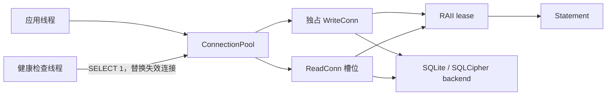

# NovaInfra SqlitePool 模块文档

`NovaInfra::SqlitePool` 为 SQLite 提供一个线程安全的连接池。它固定采用一个独占 writer 和多个只读 reader，适合读多写少、需要明确事务边界的应用。连接和预编译语句都使用 RAII 管理。

## 模块架构



### 组件职责与数据流

- `ConnectionPool` 创建数据库句柄、应用 PRAGMA/post-open 配置，并协调一个 writer 和多个 reader 槽位。
- `WriteConn` 获得唯一写连接，负责写 SQL、事务和提交/回滚；`ReadConn` 从空闲槽位取得只读连接。
- `Statement` 封装预编译语句、绑定参数和逐行读取；它通过共享 lease 延长底层连接的生命周期。
- SQLite 后端可以是系统 SQLite、bundled SQLite 或 SQLCipher；加密配置通过 `PoolConfig::postOpen` 注入。
- `PoolConfig::healthCheckIntervalMs` 大于零时启动后台健康检查线程，空闲连接探测失败会被替换。

### 并发、生命周期与失败处理

写连接是单槽位资源，调用 `write()` 的线程在其他写 lease 释放前阻塞；读连接按槽位并发，池满时
`read()` 阻塞等待。连接对象不可复制，只能移动，析构自动释放 lease。事务只在 WriteConn 上执行，
`transaction()` 负责 BEGIN/COMMIT，并在回调异常时自动 ROLLBACK。

WAL、busy timeout、page cache 和额外 PRAGMA 在连接创建时应用。健康检查只处理空闲连接，避免与持有
连接的业务操作并发使用同一个 SQLite handle；`lastHealthCheck()` 提供最近一次检查结果。

### 依赖边界

`ConnectionPool` 析构时停止健康检查线程并等待其退出，随后释放连接。应用应让所有 ReadConn、WriteConn
和 Statement 在池销毁前释放。SqlitePool 依赖 `NovaInfra::Core`、线程库和 SQLite 后端，不依赖 Logger、
ThreadPool 或 EventBus。

## 构建与测试

启用模块并构建示例：

```bash
cmake --preset linux-ninja-debug
cmake --build --preset build-linux-ninja-debug -j2
```

应用链接 `NovaInfra::SqlitePool`：

```cmake
find_package(NovaInfra CONFIG REQUIRED)
target_link_libraries(my_app PRIVATE NovaInfra::SqlitePool)
```

默认使用普通 SQLite。系统提供 SQLCipher 时，可在配置阶段设置 `-DSQLITE_BACKEND=sqlcipher`，然后通过 `PoolConfig::postOpen` 在每个连接打开后执行密钥配置。

## 快速开始

```cpp
#include <sqlite_pool/connection_pool.h>

#include <iostream>
#include <string>

int main()
{
    novainfra::sqlitepool::PoolConfig config;
    config.readConnections = 2;
    config.pragmas.emplace_back("foreign_keys=ON");

    novainfra::sqlitepool::ConnectionPool pool("notes.db", config);

    {
        auto writer = pool.write();
        writer.exec("CREATE TABLE IF NOT EXISTS notes ("
                    "id INTEGER PRIMARY KEY, title TEXT NOT NULL)");
        writer.transaction([](novainfra::sqlitepool::WriteConn &tx) {
            auto statement = tx.prepare("INSERT INTO notes(title) VALUES(?)");
            statement.bind(1, std::string("first note")).exec();
        });
    }

    {
        auto reader = pool.read();
        for (const auto &row : reader.query("SELECT id, title FROM notes ORDER BY id")) {
            std::cout << row.at("id") << ": " << row.at("title") << '\n';
        }
    }

    pool.integrityCheck();
}
```

完整示例位于 `modules/sqlite_pool/examples/sqlite_pool_example.cpp`。

## 连接模型和并发语义

- `ConnectionPool::write()` 获取唯一写连接。一个线程持有写连接时，其他线程会等待。
- `ConnectionPool::read()` 从只读连接槽位中获取一个空闲连接。所有槽位忙时，调用线程会等待。
- `readConnections == 0` 时，连接数默认为 `max(hardware_concurrency, 4)`。
- `ReadConn` 和 `WriteConn` 只能移动，析构时自动释放 lease。
- 从连接创建的 `Statement` 会继续持有对应 lease，因此语句可以在连接对象离开作用域后继续使用。
- 不要在持有连接时执行无关的慢操作，否则会减少可用并发度。

## 主要 API

### `ConnectionPool`

| API | 作用 |
| --- | --- |
| `write()` | 获取独占写连接 |
| `read()` | 获取一个只读连接 |
| `readPoolSize()` | 返回只读连接槽位数量 |
| `integrityCheck()` | 执行 `PRAGMA integrity_check`，失败时抛出异常 |
| `optimize()` | 执行 `PRAGMA optimize` |
| `checkpoint(mode)` | 在读连接空闲后执行 WAL checkpoint |
| `checkHealth()` | 检查空闲连接并替换失效连接 |
| `lastHealthCheck()` | 返回最近一次健康检查结果 |

### `ReadConn` 和 `WriteConn`

`ReadConn` 提供 `query(sql)` 和 `prepare(sql)`。`WriteConn` 额外提供 `exec(sql)`、`begin()`、`commit()`、`rollback()` 和 `transaction(callback)`。

`transaction()` 执行 `BEGIN` 和 `COMMIT`；回调抛出异常时自动执行 `ROLLBACK`，然后重新抛出原异常。

### `Statement`

语句支持位置参数和命名参数：

```cpp
auto statement = writer.prepare(
    "INSERT INTO notes(title, priority) VALUES(:title, :priority)");
statement.bind(":title", std::string("important"))
         .bind(":priority", 2.0)
         .exec();
```

常用操作包括：

- `exec()` 执行写语句并重置语句。
- `query()` 返回拥有数据的 `RowSet`，每个字段以字符串保存。
- `step()` 逐行处理结果，配合 `columnInt`、`columnInt64`、`columnDouble`、`columnText` 和 `columnNull`。
- `columnTextView()` 返回 SQLite 内部文本的非拥有视图；该视图只在下一次 `step()`、`reset()` 或语句析构前有效。

需要降低逐行处理的分配时，优先使用 `step()` 和类型化列访问器；需要简单取得全部结果时使用 `query()`。

## 配置

```cpp
novainfra::sqlitepool::PoolConfig config;
config.readConnections = 4;
config.pageCacheSize = -16000;       // 负值表示 KiB
config.busyTimeoutMs = 5000;
config.healthCheckIntervalMs = 30000;
config.journalMode = "WAL";
config.pragmas.emplace_back("foreign_keys=ON");
```

| 配置项 | 默认值 | 说明 |
| --- | --- | --- |
| `readConnections` | `0` | 自动选择 `max(硬件线程数, 4)` 个只读连接 |
| `pageCacheSize` | `-8000` | SQLite page cache；负值按 KiB 解释 |
| `busyTimeoutMs` | `5000` | SQLite 忙等待超时时间 |
| `healthCheckIntervalMs` | `30000` | 后台健康检查间隔；`0` 表示禁用 |
| `journalMode` | `WAL` | writer 使用的日志模式，通常保持 WAL |
| `pragmas` | 空 | 应用于每个新连接的额外 PRAGMA 内容 |
| `postOpen` | 空 | 每个连接打开后调用，参数表示 SQLite handle 和是否为 writer |

WAL 通常能让读写并行进行。只有在明确了解 SQLite 日志模式影响时，才修改 `journalMode`。

## 健康检查

默认情况下，连接池每 30 秒后台探测连接。探测使用 `SELECT 1`：

```cpp
auto result = pool.checkHealth();
if (result.failed != 0) {
    // 记录无法重建的连接数量
}
auto latest = pool.lastHealthCheck();
```

`HealthCheckResult` 包含 `checked`、`healthy`、`replaced`、`failed` 和 `skippedBusy`。正在使用的 reader 会被跳过；正在执行写操作时，writer 也不会被健康检查强行抢占。失效连接会关闭并尝试按原配置重建，重建失败的槽位会在后续检查中继续重试。

不需要后台监控时设置：

```cpp
config.healthCheckIntervalMs = 0;
```

## 错误处理和生命周期

SQLite 操作失败会抛出 `novainfra::sqlitepool::SqliteError`，可通过 `code()` 读取 SQLite 错误码：

```cpp
try {
    auto rows = pool.read().query("SELECT ...");
} catch (const novainfra::sqlitepool::SqliteError &error) {
    std::cerr << error.code() << ": " << error.what() << '\n';
}
```

连接池析构时会停止健康检查线程并关闭连接。应用应保证连接池的生命周期覆盖所有使用它的线程；不要在连接池析构后继续使用遗留的连接或语句。

## 生产使用建议

1. 使用 WAL，并把写事务控制在较小范围内。
2. 根据实际并发和查询耗时设置 reader 数量，不要盲目增大。
3. 让 `ReadConn`、`WriteConn` 和 `Statement` 尽快离开作用域。
4. 大结果集使用 `step()`，避免一次性构造完整 `RowSet`。
5. 启用健康检查，并监控 `failed` 和 `replaced` 计数。
6. 定期在维护窗口调用 `integrityCheck()`、`optimize()` 和 `checkpoint()`。
