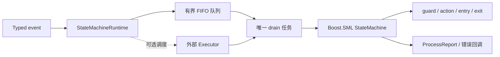

# NovaInfra StateMachine 模块文档

`NovaInfra::StateMachine` 使用 Boost.SML 提供 typed event、编译期转移表、层级状态、正交区域、历史状态、事件延迟和终止状态。NovaInfra 额外提供 `StateMachineRuntime`，把事件通过有界 FIFO 队列交给外部 executor 串行处理。Runtime 不拥有传入的状态机对象，调用方必须保证状态机的生命周期长于 Runtime。

状态机本身不创建线程。单线程场景直接调用 `process_event()`；跨线程或异步 I/O 场景使用 `StateMachineRuntime::post()`。

## 模块架构



### 组件职责与数据流

`StateMachine<Definition, Policies...>` 是 Boost.SML 的统一别名。Definition 返回编译期转移表，事件、
状态、guard 和 action 都以 C++ 类型表达；依赖对象通过构造状态机时注入。状态机本体只负责当前状态
和转移执行，不拥有线程或异步队列。

`StateMachineRuntime` 不拥有 Machine，只保存其引用和事件任务。`post()` 将事件值移动到类型擦除任务中，
放入有界 FIFO；配置了 executor 时只提交一个 drain 任务，drain 过程中串行调用 `process_event()`，因此
同一台状态机不会并发处理事件。没有 executor 时由 `poll()` 在调用线程执行同一套 drain 逻辑。

### 并发、生命周期与失败处理

Runtime 状态依次受 `RUNNING`、`STOPPING`、`STOPPED` 和 `FAILED` 控制。队列满时支持 BLOCK、REJECT 和
DROP_NEWEST；executor 拒绝 drain 任务会记录失败并停止接收事件。`shutdown(DRAIN)` 处理已经接受的事件，
`shutdown(DISCARD)` 清除未开始事件，`waitIdle()` 等待队列和 drain 任务结束。

guard、action、entry 或 exit 回调抛出异常时，Runtime 调用 `onError`、清空剩余队列并进入 FAILED；未匹配
事件通过 `onUnhandledEvent` 观察，处理结果通过 `onProcessed` 观察。回调异常会被隔离，不传播到 executor。

### 依赖边界

StateMachine 依赖 `NovaInfra::Core` 和 vendored Boost.SML，Runtime 的线程调度完全由调用方注入。它可以接入
`NovaInfra::ThreadPool` 或其他 executor，但不直接依赖这些模块，也不创建自己的 worker。

## 快速开始

状态和事件使用类型表示，事件数据直接放在事件对象中，不使用 `std::any`：

```cpp
#include <state_machine/state_machine.h>
#include <cassert>
#include <string>

struct Disconnected {};
struct Connecting {};
struct Connected {};
struct Connect {};
struct ConnectedReply { std::string peer; };

struct ConnectionMachine {
    auto operator()() const {
        using namespace novainfra::statemachine;
        const auto valid = [](const ConnectedReply& reply) {
            return !reply.peer.empty();
        };
        return make_transition_table(
            *state<Disconnected> + event<Connect> = state<Connecting>,
            state<Connecting> + event<ConnectedReply>[valid] = state<Connected>);
    }
};

novainfra::statemachine::StateMachine<ConnectionMachine> machine;
machine.process_event(Connect{});
machine.process_event(ConnectedReply{"sensor-01"});
assert(machine.is(novainfra::statemachine::state<Connected>));
```

action 和 guard 可以通过依赖注入获得业务对象：

```cpp
struct Metrics { void connected() {} };

struct Definition {
    auto operator()() const {
        using namespace novainfra::statemachine;
        return make_transition_table(
            *state<Disconnected> + event<Connect> / [](Metrics& metrics) {
                metrics.connected();
            } = state<Connecting>);
    }
};

Metrics metrics;
novainfra::statemachine::StateMachine<Definition> machine{metrics};
```

`process_event()` 返回 `true` 表示事件被当前状态图处理，返回 `false` 表示没有匹配的转移。状态机由构造函数进入初始状态；初始状态使用转移表中的 `*state<T>` 标记。

## 异步运行时

Runtime 允许多个线程安全地投递事件，但一台状态机始终只有一个 drain 任务执行：

```cpp
#include <state_machine/runtime.h>

novainfra::statemachine::RuntimeOptions options;
options.capacity = 256;
options.queueFullPolicy = novainfra::statemachine::QueueFullPolicy::REJECT;
options.executor = [&pool](novainfra::statemachine::EventTask task) {
    return pool.tryPost(std::move(task));
};

novainfra::statemachine::StateMachineRuntime runtime(machine, options);
runtime.post(Connect{});
runtime.post(ConnectedReply{"sensor-01"});
runtime.shutdown(novainfra::statemachine::ShutdownMode::DRAIN);
runtime.waitIdle();
```

`shutdown(DRAIN)` 会停止接收新事件并保留已接受事件；它本身不等待外部 executor 完成，应用应随后调用
`waitIdle()` 等待排空结束。没有 executor 时，`shutdown(DRAIN)` 同样只改变生命周期状态，必须由调用方继续调用
`poll()` 处理队列。使用外部 executor 时，executor 的生命周期必须覆盖 `shutdown(DRAIN)` 和 `waitIdle()` 的整个过程。

没有线程池时可以省略 executor，然后调用 `poll()` 驱动队列。无参数的 `poll()` 会处理到队列暂时为空；`poll(maxEvents)` 会限制本次最多处理的事件数量。多个线程可以安全调用 `poll()`，Runtime 会串行驱动状态机。若生产者持续投递事件，应使用有上限的 `poll(maxEvents)`，避免一次调用长期不返回。`post()` 返回 `ACCEPTED`、`QUEUE_FULL`、`DROPPED`、`STOPPED` 或 `EXECUTOR_REJECTED`。队列满策略支持 `BLOCK`、`REJECT` 和 `DROP_NEWEST`；状态机回调中再次 `post()` 只会排队，当前事件完成后才会执行。

Runtime 捕获事件处理期间 guard/action/entry/exit 回调抛出的异常，调用 `onError`，清空剩余事件并进入 `FAILED`，不会把异常泄漏到线程池 worker。初始状态 entry 在状态机构造时执行，构造阶段异常由调用方处理。`onUnhandledEvent` 可记录未匹配事件，`onProcessed` 可收集处理结果和指标。

## 高级状态图

Boost.SML 的层级状态、正交区域、历史状态、`process<>`、`defer<>`、`X` 终止状态和 `thread_safe<>` policy 均通过 `novainfra::statemachine` 重新导出。复杂状态图应优先使用层级和正交区域，避免把多个互相依赖的流程压缩到一个巨型扁平枚举中。

## 构建与测试

```bash
cmake --preset linux-ninja-debug
cmake --build --preset build-linux-ninja-debug -j2
ctest --test-dir build/linux-ninja-debug -R 'StateMachine' --output-on-failure
build/linux-ninja-debug/modules/state_machine/example_state_machine
```
