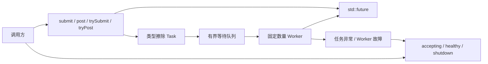

# NovaInfra ThreadPool 模块文档

`NovaInfra::ThreadPool` 是一个面向 C++17 应用的固定 worker 数量、有界队列线程池。

## 模块架构



### 组件职责与数据流

- `ThreadPool` 根据 `ThreadPoolOptions` 创建固定数量 worker 和有界等待队列。
- `submit()` 把可调用对象封装为 `packaged_task`，返回保存结果或异常的 `future`；`post()` 用于 fire-and-forget 任务。
- `trySubmit()`/`tryPost()` 在队列满或停止接收时立即返回，阻塞版本则等待队列空间。
- worker 从队列取出类型擦除 Task，执行后更新 active/idle 统计并继续消费；队列容量不包含正在执行的任务。
- 左值参数以引用保存，右值参数移动保存；调用方必须保证被引用对象在任务完成前仍然有效。

### 并发、生命周期与失败处理

队列、接受状态、活动任务数和故障信息由互斥量、条件变量和状态字段保护。worker 内的用户任务异常
只影响当前任务：`submit()` 通过 future 重新抛出，`post()` 交给 `onUnhandledException`。worker 内部
故障会使池进入 unhealthy 状态并停止接受新任务，已开始任务继续运行，剩余 worker 尽量 drain 队列。

`shutdown()` 先停止接收新任务，再等待已接受任务完成并 join 所有 worker；析构执行相同的 drain 语义。
`waitIdle()` 只等待调用时已接受的任务全部结束。worker 内不能调用阻塞提交、`waitIdle()` 或 `shutdown()`，
否则会触发死锁保护或终止流程。

### 依赖边界

ThreadPool 依赖 `NovaInfra::Core` 和 C++ 线程库，不依赖 EventBus、StateMachine 或 Logger。其他模块通过
`tryPost` 注入 ThreadPool 时，必须自行处理队列满和池关闭返回值。

## 快速开始

```cpp
#include <thread_pool/thread_pool.h>

novainfra::threadpool::ThreadPoolOptions options;
options.workerCount = 4;
options.queueCapacity = 1024;
novainfra::threadpool::ThreadPool pool(options);

auto result = pool.submit([](int value) { return value * 2; }, 21);
pool.post([] { /* background work */ });
assert(result.get() == 42);
```

当有界队列已满时，`submit` 和 `post` 会施加背压并等待队列出现空闲位置。
`queueCapacity` 只限制排队等待的任务，不包含 worker 正在执行的任务。
对应的 `trySubmit` 和 `tryPost` 版本不会阻塞；队列没有空间时分别返回 `std::nullopt` 和 `false`。
在线程池关闭后提交任务会抛出 `std::runtime_error`；非阻塞版本则通过返回值报告失败。

任务参数的值类别会被保留：右值参数会移动到任务中，左值参数会以引用方式传递。调用方必须保证
左值对象在线程执行完成前保持有效，并自行保证并发访问安全；需要显式引用语义时可以使用 `std::ref`
或 `std::cref`。

`submit` 会将任务异常保存到返回的 `std::future` 中，并由调用方通过 `get()` 重新抛出。
`post` 产生的异常会传递给 `ThreadPoolOptions::onUnhandledException`；如果没有配置异常处理器，
线程池会将诊断信息写入 `stderr`，对应的 worker 仍可以继续执行后续任务。

线程池析构时会执行 drain shutdown，等待已经接受的任务完成。显式调用 `shutdown()` 是幂等的，
会拒绝新任务，并等待所有已接受的任务执行完成。
不能从本线程池的 worker 任务中调用 `shutdown()`；当前实现会输出诊断并调用 `std::terminate()`。

`waitIdle()` 会等待任务队列为空且当前没有正在执行的任务。它只覆盖等待开始时已经接受的任务；
如果其他生产者随后继续提交，`waitIdle()` 返回后仍可能有新任务。需要完整排空时，应先停止生产者，
再调用 `shutdown()`。不能在线程池自身的 worker 任务中调用 `waitIdle()`，否则可能产生死锁；这种调用
会抛出 `std::logic_error`。

线程池 worker 在队列已满时不能调用阻塞版本的 `post` 或 `submit`，否则会因为所有 worker 相互等待而
死锁；这种调用会立即抛出 `std::logic_error`。worker 内应优先使用 `tryPost` 或 `trySubmit`，并处理
队列已满的返回值。队列有空间时，worker 提交仍可以正常入队。当前线程池不是 fork-join 或
work-stealing 执行器；即使提交成功，worker 之间互相等待同一线程池的 future 仍可能形成任务级死锁。

如果 worker 内部发生非用户任务异常，线程池会进入故障状态并停止接受新任务。故障信息可以通过
`healthy()` 和 `failure()` 查询，也可以通过 `ThreadPoolOptions::onWorkerFailure` 接收通知。
已经开始执行的任务会继续运行；队列中的任务会优先交给剩余 worker drain。若所有 worker 都发生
故障，尚未开始的 `submit` 任务会因 `broken_promise` 结束。故障回调在 worker 上执行，应保持短小
且不可阻塞，也不能等待同一个线程池的任务或调用 `shutdown()`。

`workerCount` 为零时使用 `std::thread::hardware_concurrency()`，并至少创建一个 worker。CPU 密集型任务
通常可将 worker 数量设置为逻辑 CPU 数附近；I/O 密集型任务可以适当增加，但应结合任务阻塞时间和系统负载
进行压测。高核心数机器上默认值可能创建较多线程，生产环境建议显式设置数量。

## 构建与测试

```bash
cmake --preset linux-ninja-debug
cmake --build --preset build-linux-ninja-debug -j2
ctest --test-dir build/linux-ninja-debug -R '^ThreadPool' --output-on-failure
```

基准通过 `-DNOVAINFRA_THREAD_POOL_BUILD_BENCHMARKS=ON` 构建，覆盖 `post`、`submit`、单/多生产者、
小/大队列和较大 lambda 捕获；其输出用于比较当前机器上的基线，不等同于业务任务性能。
